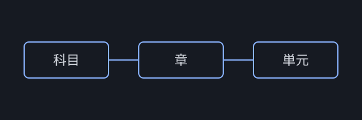

# テキスト表示の確認

この単元は表示確認用です。動画はありません。

## 見出しと強調

文章の中で **重要な語句** は太字で、*補足* は斜体で表示されます。

> 引用ブロックは、定義や注意書きに使えます。

### 箇条書き

- 項目1
- 項目2
  - 入れ子の項目
1. 番号付きの手順1
2. 番号付きの手順2

## 表

| 用語 | 説明 |
| --- | --- |
| 科目 | いちばん大きなまとまり |
| 章 | 科目の中のまとまり |
| 単元 | 1回で学ぶ範囲。動画とテキストを持つ |

## 画像



## 数式

インライン数式は $a^2 + b^2 = c^2$ のように表示されます。

$$
\sum_{k=1}^{n} k = \frac{n(n+1)}{2}
$$

## コード

```sql
SELECT name FROM students WHERE score >= 80;
```
