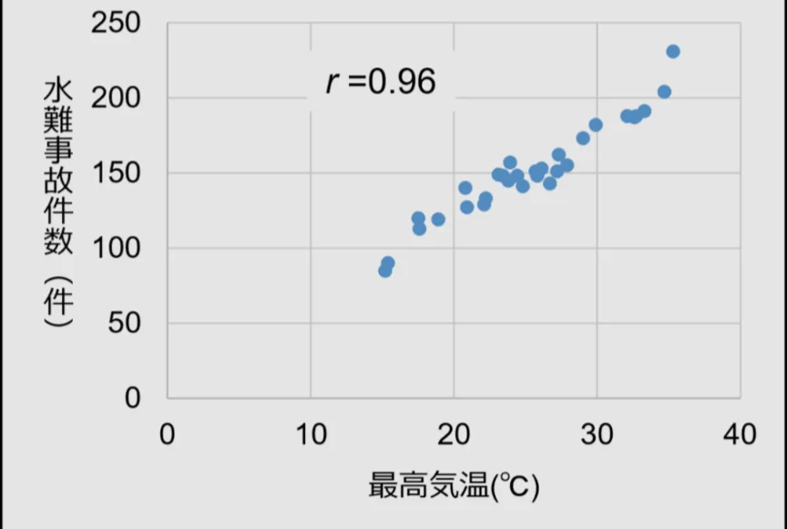

# 統計的誤謬

- 数字・統計を使った主張は説得力があるように見えますが、様々な形で誤りを含むことがあります。
- 相関と因果の混同：二つの値が**相関**する（一緒に動く）からといって、一方が他方の原因とは言えません。
    - よく知られている例として、「最高気温が高いほど、水難事故が増える」というデータがあります（下図）。
        
        
        
    - しかし、気温が高い「から」、水難事故数が増えたわけではありません。これは第三の要因によるものです。気温が高く、海や川に行く人が増えた「から」、結果として水難事故が増えたのです。
    - これを**疑似相関**と呼びます。**相関は因果を意味しない**」は統計の**最重要原則**です。
        
        
- **サンプリングバイアス**：調査対象のサンプルが母集団（調査したい対象の全体）を代表していないことがあります。「SNSでアンケートをとったところ、80%がAを支持した」──SNSユーザーは全人口を必ずしも代表しません。
    - 「病院の患者を調査したところ、〇〇の人は不健康だった」──健康な人は病院に来ないというバイアスがあります。
- **生存者バイアス**：成功した例・残存した例のみを観察して一般化する。「独立すれば収入が上がる」──収入が上がった人の発言のみが過大に評価されている可能性があります。失敗者の声は聞こえにくいのです。
- 絶対リスクと相対リスクの混同：「この薬でがんリスクが50%減少」──もし元のリスクが0.02%なら50%減で0.01%です。相対リスクの数字は元のリスクが小さいと誇張に見えます。
- 平均の罠：「平均年収〇〇万円」──平均は極端な値に引きずられます。少数の超高収入者が平均を引き上げると、多数の人は平均以下になります。**中央値**（真ん中の値）の方が実態を反映することが多い。
