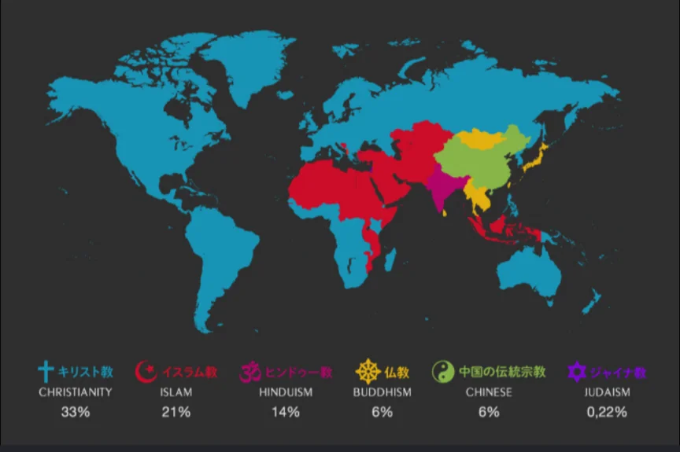

# 世界の宗教の分布

- 世界の宗教の分布を以下に示します。
    - キリスト教徒は約24億人、イスラム教徒は約19億人、ヒンドゥー教徒は約12億人、仏教徒は約5億人います。
    
    
    

- 宗教の地理的分布には歴史的な理由があります。キリスト教がアメリカに広まったのは大航海時代の植民地支配と宣教活動によるものですし、イスラム教が中東から東南アジアまで広まったのは7〜8世紀の軍事的拡大と商人による布教によるものです。
- 「無宗教」も世界人口の約16%に達しており、特に日本・ヨーロッパで増えています。
    - ただし、初詣やクリスマスのように、無宗教でも文化的な宗教行為を行う人は多く、「信仰」と「文化」の境界は曖昧です。
- 無宗教が増えている理由として、おもに次の4つが指摘されています。
    - **科学と教育の広まり**：自然現象や病気を科学で説明できるようになり、宗教に答えを求める場面が減った。
    - **豊かで安全な社会**：医療・年金・保険などの制度が、病気や老後への不安をやわらげるようになった。
    - **都市化と個人主義**：地域や家族のつながりがうすれ、信仰が親から子へ受けつがれにくくなった。
    - **宗教団体への不信**：不祥事や、宗教がからむ争いの歴史への失望から、組織や宗教から距離を置く人が増えた。
    - ただし世界全体では、信者の多い地域で人口が増えているため、宗教を持つ人の割合は今後も大きくは減らないという予測もあります。
