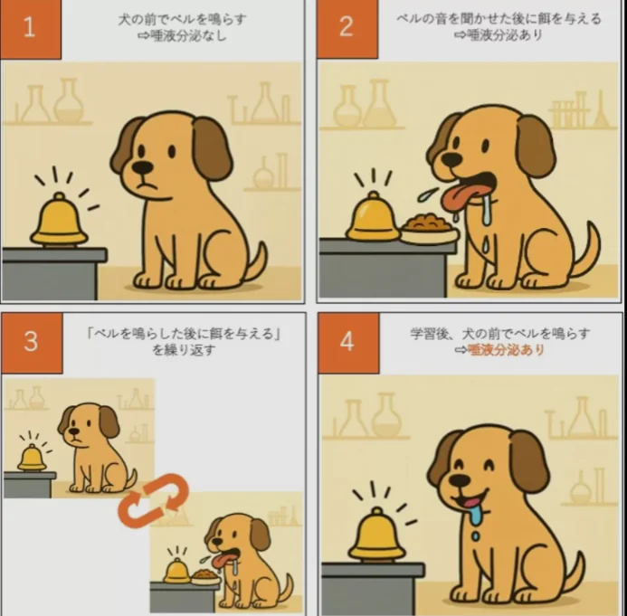

# 心理学の歴史と分野

- 心理学は哲学から独立した比較的新しい科学です。初期の心理学は「意識の構造を内省によって分析する」という方向でしたが、「観察できない意識より、観察できる行動を研究すべきだ」という行動主義が主流となりました。
- 「**パブロフの犬**」と呼ばれる実験があります。この実験では、犬にエサをやる前に必ずベルを鳴らす、ということを繰り返すと、犬はベルの音を聞いただけでもヨダレを垂らすようになりました。これは古典的**条件づけ**と呼ばれており、本来無関係のはずのものでも、学習によって行動に結びつけることができる、ということを表しています。
    - 我々人間も、気づかないうちに様々な学習をしていると考えられます。
    
    
    
- **スキナーのオペラント条件づけ**の実験では、ネズミやハトを使い、犬のしつけのように、ある行動ができたら報酬（エサ）を与える、という実験を行い、どのように報酬を与えるのが最も効果的かを計測しました。ある行動ができるたびに毎回報酬を与えると、行動の習得は早かったものの、報酬がなくなるとすぐに行動が消えてしまう傾向がありました。逆に、毎回ではなく時々報酬を与えるようにすると、習得に時間がかかるものの、報酬がなくなっても行動が消えにくい傾向がありました。
    - この結果は人間にも当てはまります。ギャンブルなどがやめられないのはこの効果によるものだと考えられます。
- 1950〜60年代にはコンピュータの登場で「人間の心もコンピュータのような情報処理システムだ」と考える**認知心理学**が台頭します。単に行動を観察するだけでなく、行動を通して、その背後にある思考・記憶・判断のプロセスを研究する方向に転換しました。
