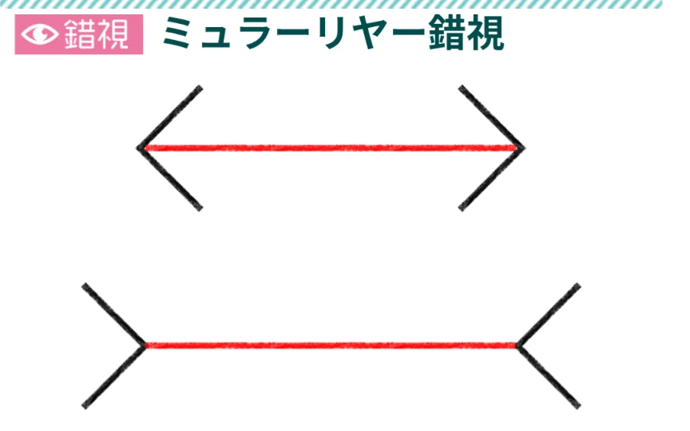
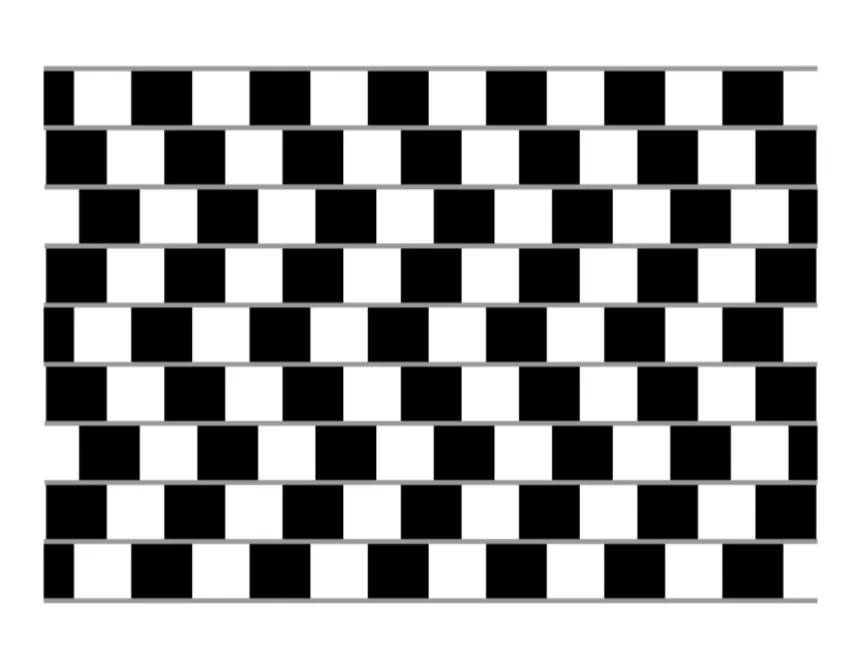
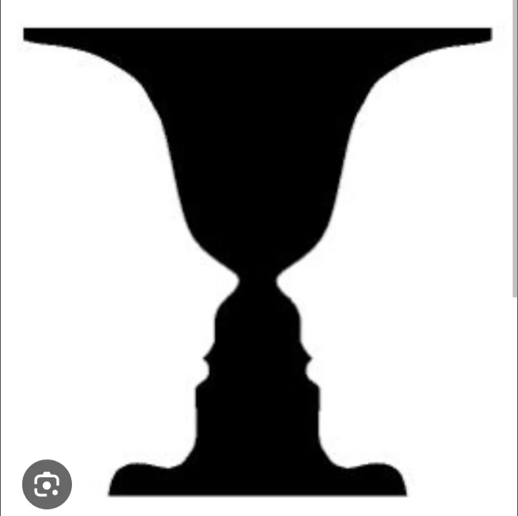

# 感覚と知覚

- 目で光を受け取ることと、何かを「見る」ことは違います。前者は**感覚**、後者は**知覚**です。
    - 感覚は物理的な刺激を神経信号に変換するプロセスで、知覚はその信号を脳が解釈して意味のある情報にするプロセスです。
- この違いが最もわかりやすいのが**錯視**です。**ミュラー・リヤー錯**視では、同じ長さの線分が異なる長さに見えたり、チェルナーの錯視では、真っ直ぐなはずの横線が傾いて見えたり……これらは目が「間違っている」のではなく、脳が過去の経験・文脈・仮定に基づいて解釈を加えているためです。
    
    
    
    
    

- **知覚**は受動的な「受け取り」ではなく、能動的な「構築」です。私たちは見ているものを「そのまま」受け取っているのではなく、脳が大量の推測・補完・解釈を加えた結果を「現実」として体験しています。過去の知識・期待・文脈が知覚に影響します。
- 有名な例として「**ルビンの壺**」（壺にも見えるし、向かい合う顔にも見える）があります。「どちらが正しいか」という問いに答えはなく、脳が複数の解釈の間を揺れ動いているのです。
    
    
    

- この知識は日常生活にも応用できます。「同じ出来事でも人によって見え方が違う」のは、それぞれが異なる過去経験・期待・注意の向け方を持っているためです。「客観的に見る」ことの難しさは、知覚の仕組みから必然的に導かれます。
