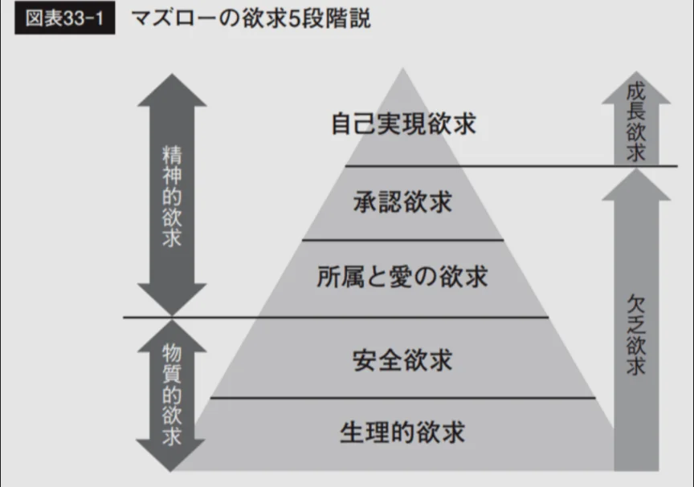

# 動機づけの理論

- 人間が行動する理由（動機）を研究するのが動機づけの心理学です。
- **マズロー**の**欲求階層説**は最も有名な動機づけ理論で、人間の欲求をピラミッド状に階層化しました。
    - 生理的欲求（食・睡眠）
    - 安全欲求（身の安全・安定）
    - 所属・愛の欲求（仲間・愛情）
    - 承認欲求（尊重・評価）
    - 自己実現欲求（潜在能力の発揮）
    
    
    
- この理論は非常に直感的でわかりやすいですが、科学的な証拠は弱く、「必ず下から順番に」満たされる、というわけではありません。
    - 「お腹が空いても芸術創造に没頭できる」人はいます。しかし、概念の枠組みとして人間の欲求を整理するのに有用です。
- 「面白いから」「やりがいがあるから」という内側からの欲求によるモチベーションを、**内発的動機づけ**といいます。逆に、「お金がもらえるから」「怒られるから」という外側からのモチベーションは、**外発的動機づけ**といいます。
- **アンダーマイニング効果**は、もともと内発的に楽しんでいた活動に外的報酬を与えると内発的動機が下がる現象です。お絵描きが好きな子どもに「上手に描けたらお菓子をあげる」と言い続けると、お菓子がない状況でお絵描きをしなくなります。賞罰による動機づけの限界を示す重要な発見です。
    - 勉強しようと思ったタイミングで、親に勉強しろと言われるとやる気がなくなるのもこの効果によるものです。
