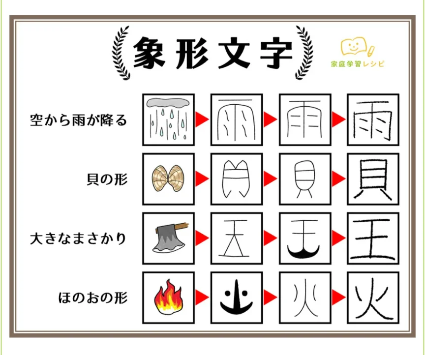

# 漢字の成り立ち

- **象形**（しょうけい）文字は、目に見えるものの形をそのまま絵にして文字にしたものです。漢字の中では最も古い成り立ちで、山（山の形）・川（水の流れ）・日（太陽）・月・木・口などがこれにあたります。
    
    
    

- **指事**（しじ）文字は、形に表しにくい抽象的な概念を、記号で示した文字です。数はあまり多くありません。上・下（基準線の上下に点を置いた）や、一・二、本、末などがこれにあたります。
    - 「本」の「本」という字は、木の根元部分に印をつけて「根本・もと」を表しました。「末」は逆に先端に印をつけています。
- **会意**（かいい）文字は、二つ以上の象形・指事文字を組み合わせて、新しい意味を表した文字です。
    - 森（木が三つ→たくさんの木）
    - 明（日＋月→明るい）
    - 休（人＋木→木に寄りかかって休む）
    - 男（田＋力→田んぼで力仕事をする人）
- **形声**（けいせい）文字は、音を表す部分（**音符**）と、意味を表す部分（大抵は**部首**）を組み合わせた文字です。漢字全体の約90%がこのタイプと言われており、最も重要な成り立ちです。語（言＋吾）や飯（食＋反）などがこれにあたります。
    - 例えば、晴・清・情・請などは、すべて「青（せい）」という音符を共有しており、実際に音読みが「セイ」となります。それぞれの意味は、部首によって区別されます。
    - このような特徴は読み方（音読み）や意味を推測する手がかりになります。知らない漢字でも「この部分は音を表している」と気づけると、読み方が推測できることがあります。
