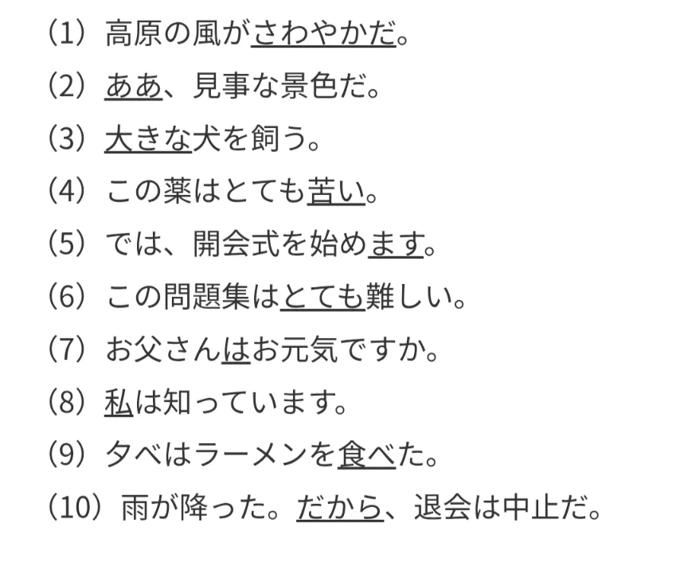
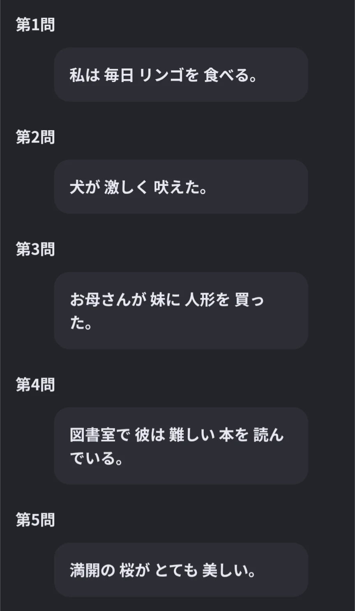
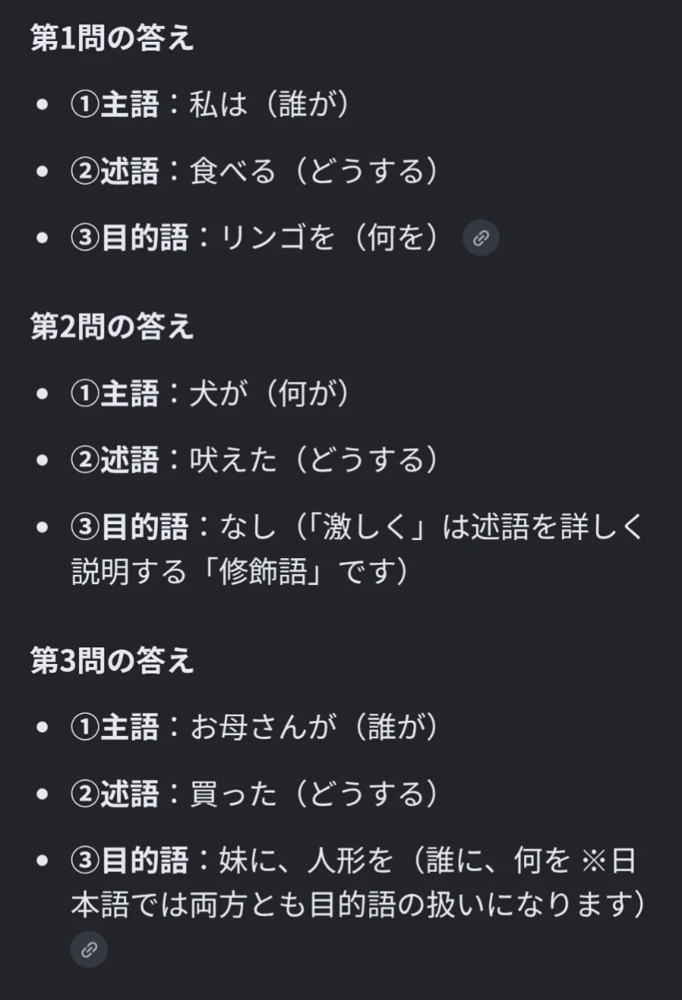
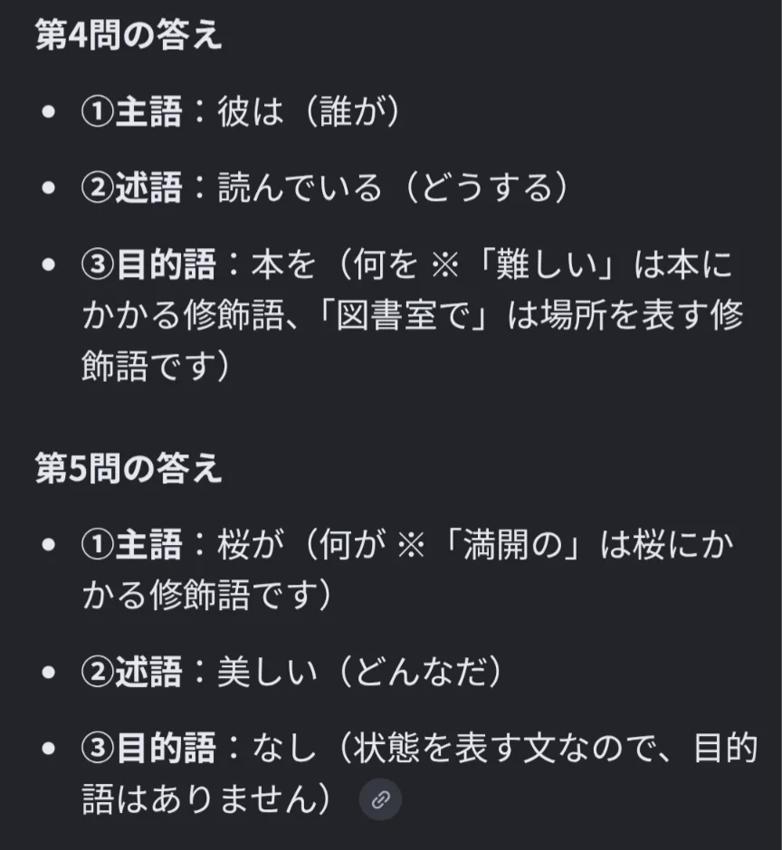

# 主題と主語

- 助詞の中でも、「は」と「が」の使い分けは特に間違いやすいポイントです。「は」は**主題**（話の中心として取り上げる）を表し、「が」は**主語**（動作・状態の主体）を表すことが多いです。
- 「象は鼻が長い」という文章では、主語が「象」なのか「鼻」なのかの判別が難しく、これは英語などにはない日本語特有の特徴です。「長い」のはあくまで鼻であって、象そのものではないため、「鼻」が主語になります。象は、文のテーマを表す「主題」です。

- 問題
    
    ①下線部の引かれている単語の品詞を答えよ。
    
    
    
    ②次の文について、主語、述語、目的語がそれぞれ何に当たるか答えよ。なお、目的語がないものもある。
    
    
    
- 解答
    - ①
        
        （1）形容動詞
        
        （2）感動詞
        
        （3）連体詞
        
        （4）形容詞
        
        （5）助動詞
        
        （6）副詞
        
        （7）助詞
        
        （8）名詞
        
        （9）動詞
        
        （10）接続詞
        
    - ②
        
        
        
        
        
