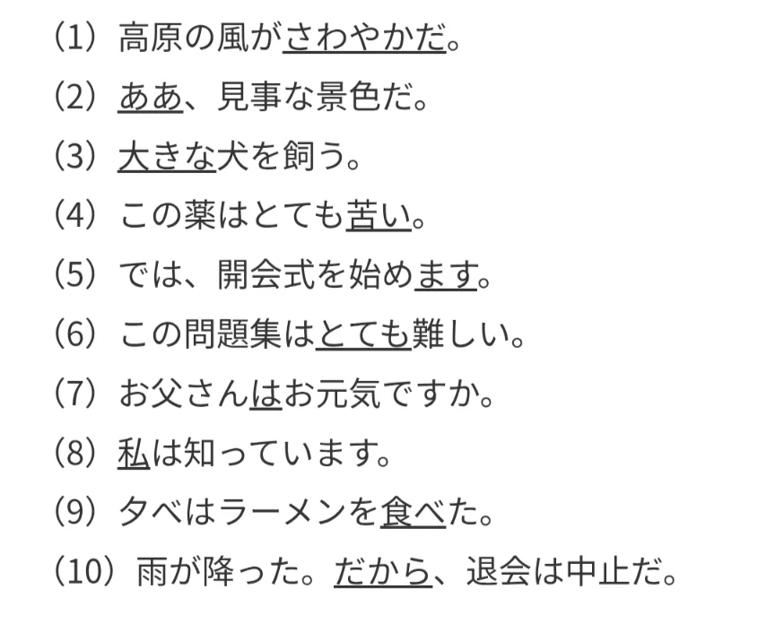
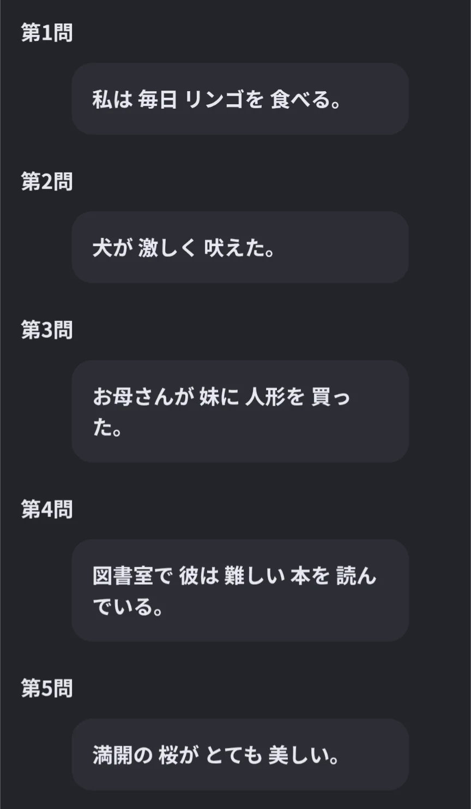
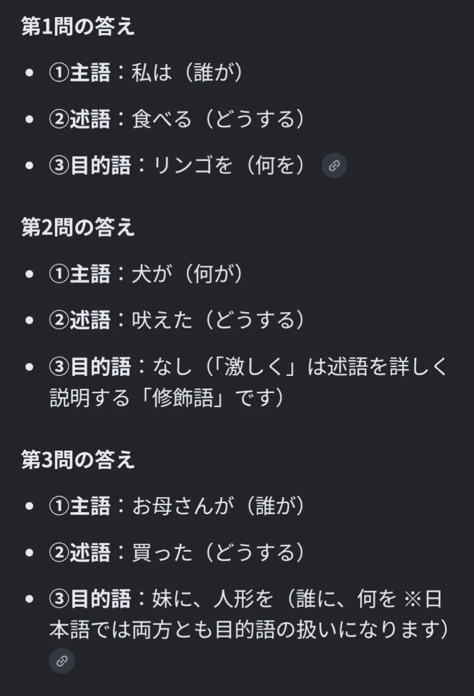
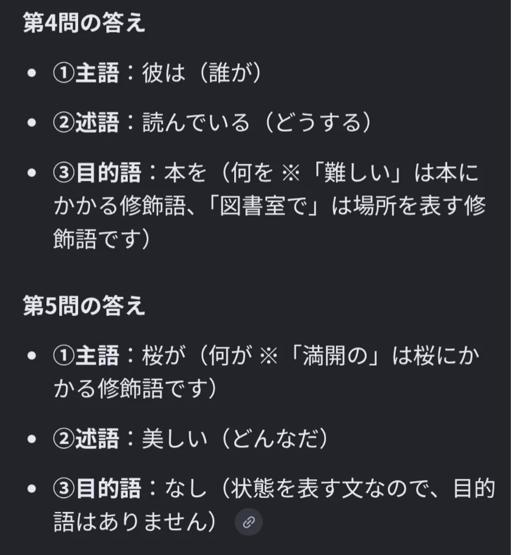

# 練習問題

この章（文法の基礎）の練習問題をまとめたものです。

## 主題と主語（JA02-05）

- 問題
    
    ①下線部の引かれている単語の品詞を答えよ。
    
    
    
    ②次の文について、主語、述語、目的語がそれぞれ何に当たるか答えよ。なお、目的語がないものもある。
    
    
    
- 解答
    - ①
        
        （1）形容動詞
        
        （2）感動詞
        
        （3）連体詞
        
        （4）形容詞
        
        （5）助動詞
        
        （6）副詞
        
        （7）助詞
        
        （8）名詞
        
        （9）動詞
        
        （10）接続詞
        
    - ②
        
        
        
        
