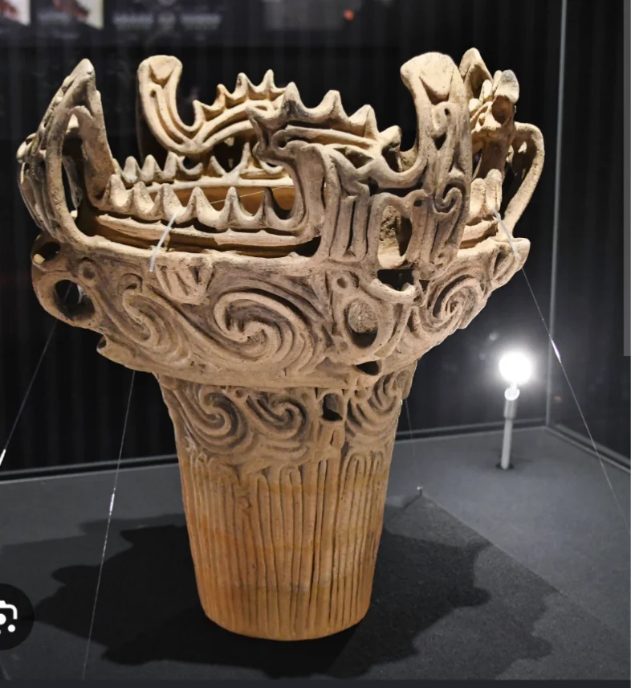
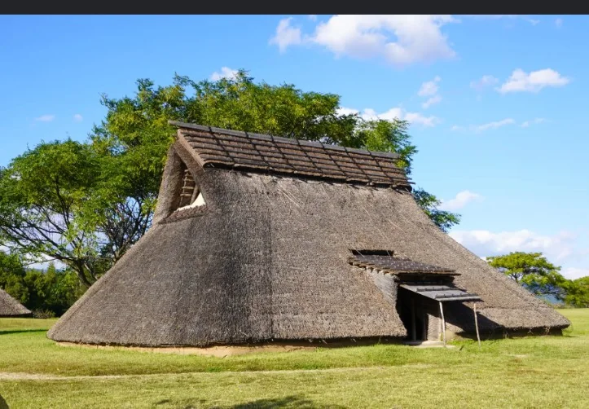

# 縄文文化の特徴

- 日本列島には約3万8000年前から人が暮らしていましたが（旧石器時代）、約1万6000年前になると土器が作られ始めます。ここからの時代を「**縄文時代**」と呼ぶのは、土器の表面に縄を転がしてつけた模様が特徴的だったからです。
    
    
    

- 縄文時代は、農耕はまだなく、狩猟や採集が中心でした。住まいは地面を掘り下げた「**竪穴住居**」です。また、食べたあとの貝殻や骨を捨てた場所が「**貝塚**」として残っており、当時の食生活を知る手がかりになっています。
    
    
    

- 農耕社会に比べると「遅れた時代」と思われがちですが、近年の研究では格差が小さく、争いの痕跡も少ない、ある意味で平和な時代だったことがわかっています。**土偶**という人形も多く作られていて、豊穣や安産を祈るためのものだったと考えられています。
