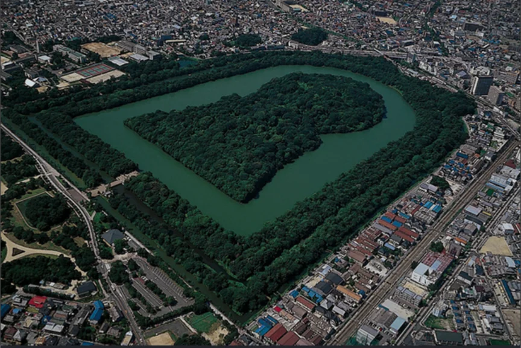

# 古墳と大和政権

- 3〜7世紀ごろ、日本各地に巨大な墓が作られました。これが「**古墳**」です。**前方後円墳**（前が四角く後ろが丸い独特の形）が最も有名で、大阪の**仁徳天皇陵**は全長約486メートル。エジプトのピラミッドをしのぐ世界最大級の墳墓です。
    
    
    
- 古墳を作れるということは、大量の労働力を動員できる権力者がいたということ。この時代、近畿地方を中心にした「**大和政権**（ヤマト王権）」が列島各地の豪族を束ねながら、徐々に統一的な支配体制を築いていました。
    - 卑弥呼のものと推定されている古墳もあり、邪馬台国と大和政権、いわば天皇家との関連性が研究されています。
- 古墳の周りには「**埴輪**」が並べられていて、人物・動物・家など様々な形があります。武人の埴輪、踊っている人の埴輪、馬の埴輪……眺めているとなんとなく当時の人たちの生活が伝わってくるような気がします。
