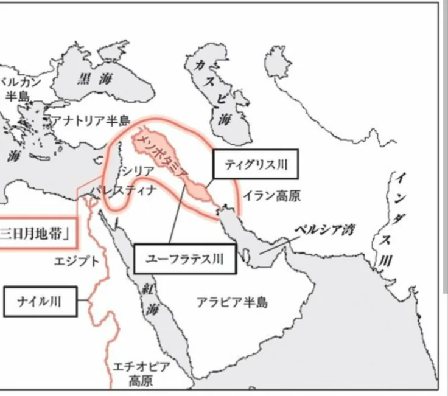
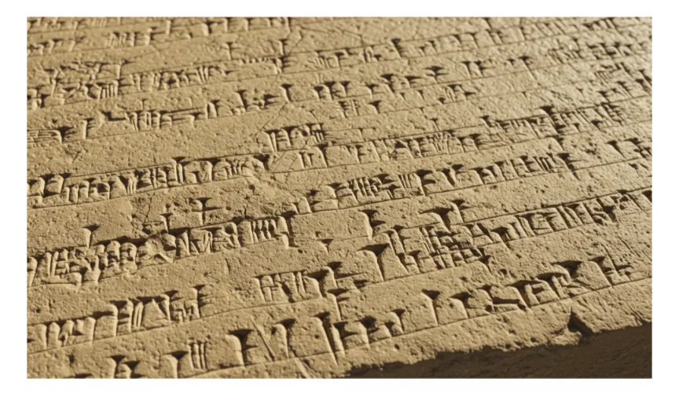

# メソポタミア文明

- 「文明の発祥地」として最もよく知られるのが**メソポタミア**（現在のイラク）です。2つの大きな川に挟まれたこの地域に、紀元前3500年ごろ世界最初の都市文明が生まれました。
    
    
    

- **シュメール人**が築いた**都市国家**（都市レベルの小さな国家のこと）では、神殿を中心とした社会が形成されました。最も重要な発明の一つが**楔形文字**です。粘土板に葦のペンで押しつけて記した最古の文字体系です。
    
    
    
- バビロニアのハンムラビ王が制定した**ハンムラビ法典**は「**目には目を、歯には歯を**」という同害報復の原則で知られます。ただしこれは「やられたら同じだけ仕返してよい」というより、「それ以上の報復を禁止する」という過剰復讐への歯止めの意味合いがありました。世界最古の法律の一つです。
- メソポタミア文明は**洪水神話**も残しています。**ノアの箱舟**に似た洪水物語が「**ギルガメシュ叙事詩**」に記されており、**旧約聖書**（キリスト教とユダヤ教の聖典）より古い時代のものです。人類が洪水を恐れた記憶が、各地の文明で似た神話を生んだのかもしれません。
    - 旧約聖書がギルガメッシュ叙事詩をパクった可能性も議論されています。
