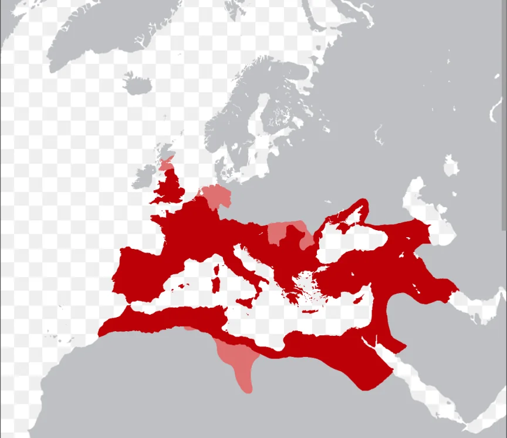

# ローマ帝国の繁栄

- カエサルの暗殺後、ローマは再び内乱に陥ります。カエサルの後継者を名乗る**オクタウィアヌス**、カエサルの部下**アントニウス**、そしてエジプトの**クレオパトラ**が絡む権力争いの末、オクタウィアヌスが勝利し初代皇帝**アウグストゥス**となりました。共和政ローマから帝政ローマへの転換です。
- その後約200年間は「**パクス・ロマーナ**（ローマの平和）」と呼ばれる安定と繁栄の時代が続きました。総延長約40万kmに及ぶ街道網（「**すべての道はローマに通ず**」）、水道橋による上下水道、統一された法体系……これらは現代のインフラの原型と言えるものです。以下はローマ帝国の最大版図（領土）です。
    
    
    

- 「**五賢帝**」と呼ばれる優れた皇帝が続いた時代（96〜180年）が最盛期です。最後の五賢帝**マルクス・アウレリウス・アントニヌス**は哲人皇帝として知られ、戦場で書き続けた日記「**自省録**」を残しています。「今日も嫌な人間に会った。でも私が怒るかどうかは私が決められる」というような内省が続くこの日記は、2000年前の皇帝が現代人と全く同じことで悩んでいたことを伝えており、今でも自己啓発書として読まれています。
    - 権力の頂点にいながら「自分を律すること」を日々書き続けた、というのは彼の誠実な人柄を示しています。
