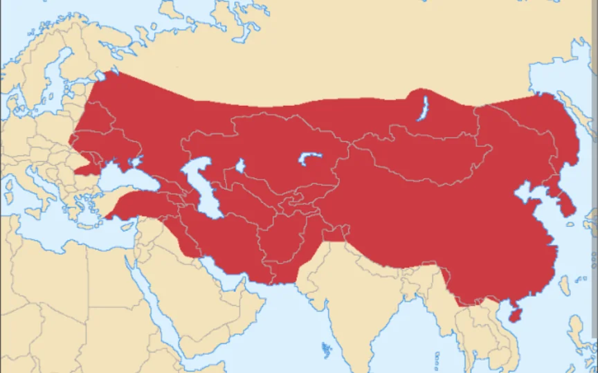

# モンゴル帝国とチンギス・ハン

- **チンギス・ハン**（1162年ごろ〜1227年）の生涯はまさにドラマです。モンゴル高原の小さな部族の長の子として生まれ、幼少期に父を毒殺されて部族を離散させられ、ライバルの部族に捕らえられて首かせをはめられた少年が、後に史上最大の陸上帝国を築きます。
    - 若き日に妻が誘拐されたとき、彼は命がけで取り戻しに向かいました。これは当時の遊牧民社会では稀な行動で、妻への深い愛情を示すエピソードとして語られます。部下への報酬も惜しまず、戦利品を気前よく分配したため、強烈な人望を集めました。
- モンゴルの諸部族を統一した後、21年かけて、東は中国から西は中央アジア・イランに至る大帝国を築きました。チンギス・ハンの戦略の特徴は「降伏した都市には寛大、抵抗した都市は徹底的に破壊する」というメリハリのある支配で、多くの都市は戦わずして門を開きました。また、能力主義を徹底し、民族や出身に関係なく優秀な人物を登用しました。
- 一方で征服地での虐殺・略奪は凄惨でした。「最大の帝国を作った英雄」と「最悪の破壊者」という両面を持つ人物として、チンギス・ハンは歴史上最も評価が分かれる存在です。以下はモンゴル帝国の最大版図です。
    
    
    
