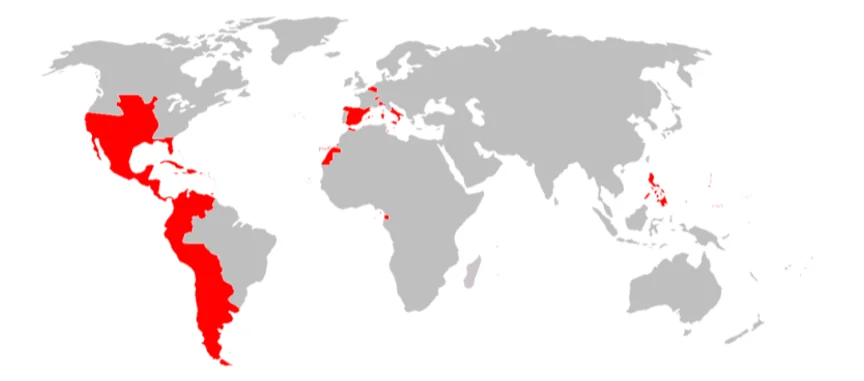

# 教皇権の衰退・マグナカルタ・百年戦争

- 中世ヨーロッパを長く支配してきたカトリック教会の権威は、13〜14世紀にかけて大きく揺らいでいきます。その象徴的な事件が**アナーニ事件**です。
- フランス王フィリップ4世は聖職者への課税をめぐってローマ教皇ボニファティウス8世と激しく対立しました。フィリップはついに教皇をイタリアのアナーニで拘束するという前代未聞の行動に出ます。教皇はすぐに解放されましたが、この屈辱から体調を崩して間もなく死亡しました（**憤死**）。
    - かつてカノッサで皇帝が教皇に雪の中で許しを請うた（カノッサの屈辱）のとは正反対に、今度は王が教皇を拘束したのです。この事件は「もはや教皇といえども世俗の王権に勝てない」という時代の変化を鮮明に示しました。
- 一方、イングランドでは、王権を制限する動きが早くから進んでいました。横暴な国王**ジョン**に対して貴族たちが反乱を起こし、**マグナカルタ**を認めさせました。「議会の同意なしに課税できない」「法による裁判なしに逮捕・投獄できない」という内容を含むこの文書は、世界で最初に王権を成文法で制限したものとして、後の民主主義・法の支配の原点とされています。
- 13世紀末から14世紀にかけて、イングランドとフランスは深刻な対立に突入していきます。もともとイングランド王家はフランス系の王朝の流れを汲み、フランス国内に広大な領土を持っていました。フランス王家との王位継承問題も絡み、1337年に**百年戦争**が勃発します。
- 百年戦争の終盤に現れた英雄が**ジャンヌ・ダルク**です。フランス東部の農村出身の少女で、「神の声を聞いた」として立ち上がり、苦境に陥っていたフランス軍に加わります。シャルル7世の軍と合流してオルレアンを解放し、フランス軍の士気を一気に高めました。
    - しかし、イングランドと同盟する派閥に捕らえられ、宗教裁判にかけられて19歳で火刑に処されます。
- 百年戦争は、最終的にフランスがカレー以外のイングランド領をすべて奪還して1453年に終結します。

- この百年戦争の時代にヨーロッパ本土の政治地図を大きく動かしていたのが結婚政策による領土拡大で知られる**ハプスブルク家**でした。オーストリアを本拠地とするこの家は、**神聖ローマ帝国**（現在のドイツ・オーストリア・チェコなどにまたがる緩やかな連合体）の皇帝位をほぼ独占しながら、婚姻によってスペイン・ネーデルラント（現在のオランダ・ベルギー）・ハンガリー・ボヘミアなどを次々と手に入れました。
    - 「戦争は他の国々にまかせておけ、幸せなオーストリアよ、汝は結婚せよ」というラテン語の格言があるほどです。
- 最盛期の**カール5世**（1519〜1556年在位）はスペイン王・神聖ローマ帝国皇帝・ネーデルラント君主などを兼任し、ヨーロッパ最大の支配者となりました。新大陸の植民地もスペイン王として支配しており、その帝国は文字通り「日**の沈まない帝国**」でした。以下は最大版図です。
    
    
    
