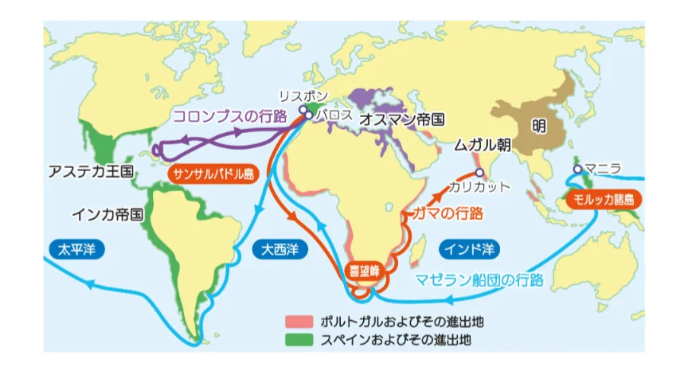

# コロンブスと大航海時代

- 15世紀後半、ヨーロッパはアジアへの新たな航路を求め、**大航海時代**が始まります。
- 理由は２つあります。1つは、オスマン帝国の台頭でシルクロードを通じたアジアへの陸路が不安定になったこと。もう一つは羅針盤・天文航法・外洋航行に適した船など、技術的な進歩が追い風になったことです。
- ポルトガルはアフリカ沿岸を南下してインドへの海路を開く戦略をとり、1498年に**ヴァスコ・ダ・ガマ**がインドへの直航路を開きました。
- 一方スペインは**コロンブス**を西へ送り出しました。「地球は丸いから西に進めばアジアに着く」という発想を実行に移したコロンブスは1492年にカリブ海に到達しましたが、死ぬまで「ここはアジア（インド）だ」と信じ続けました。
    - 新大陸を発見しながら気づかなかった歴史上最大の「誤解」です。先住民が今も「インディアン」と呼ばれるのはこの誤解の名残です。
    - この航海がもたらした「**コロンブスの交換**」は世界を大きく変えました。トマト・じゃがいも・とうもろこしがヨーロッパへ、小麦・馬・天然痘がアメリカへと渡ります。特に天然痘は先住民に免疫がなく、後のアステカ・インカ帝国滅亡の一因になりました。
- 1522年には、スペインが派遣した**マゼラン**の艦隊が人類初の世界一周を成し遂げました（マゼラン自身は途中のフィリピンで戦死）。
    
    
    
