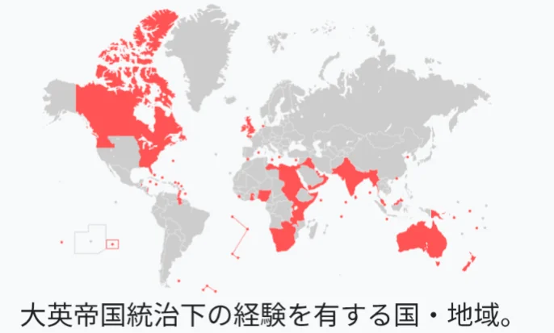

# オーストリア継承戦争と七年戦争

- 18世紀半ば、ハプスブルク家を継承した**マリア・テレジア**は、女性の継承に反対するプロイセン・フランスなどの攻撃を受けました（**オーストリア継承戦争**）。プロイセン王**フリードリヒ2世**に富裕な工業地域シュレジエンを奪われながらも、軍と行政の改革で国力を立て直します。
    - 16人の子どもを産みながら国政を切り盛りした彼女はハプスブルク家最大の政治家と称されており、末娘がフランス王妃となったマリー・アントワネットです。
- シュレジエン奪還を目指すオーストリアとプロイセンの対立は**七年戦争**に発展します。この戦争は北アメリカ・インド・カリブ海にまで飛び火した「世界初の世界大戦」とも呼べる規模でした。
- 結果イギリスがカナダとインドでフランスを破り、世界最大の植民地帝国への道を確実にしました。
    
    
    
