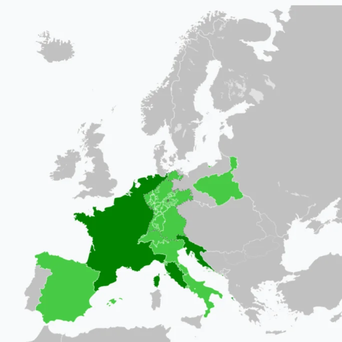

# ナポレオンの台頭と没落

- 恐怖政治の後、フランスは混乱した政局が続きます。この混乱の中から彗星のように台頭したのが**ナポレオン**・ボナパルトです。
    - 1799年のクーデターで権力を握り1804年に皇帝となり、各国を征服していきました。「革命の子」でありながら「皇帝」になるという矛盾を意に介しませんでした。以下は最大版図です。
        
        
        
    
- しかし、1812年の**ロシア遠征**では焦土作戦と冬将軍の前に60万の大軍のうち帰還できたのは10万に満たず、1815年の**ワーテルローの戦い**でイギリスをはじめとする各国に敗北。孤島に流刑となって没しました。
- 征服地の人々はナポレオンに支配されたことで「自分たちはフランス人ではない」というナショナリズムに目覚め始めます。これが後のイタリア・ドイツ統一運動の伏線になります。
