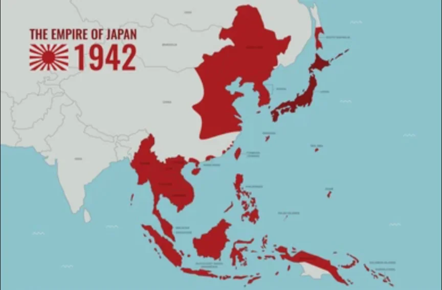

# 第二次世界大戦と日本・中国の関わり

- 日本では20世紀に入り軍部が政治的影響力を強めていきました。1931年の**満州事変**（軍が独断で起こした謀略的な軍事行動）でアジア進出を本格化させ、1937年の**盧溝橋事件**をきっかけに中国と全面戦争に突入します。
- 日本は1941年に**真珠湾**を奇襲攻撃してアメリカと開戦し、当初は東南アジア各地を制圧しましたが、**ミッドウェー海戦**（1942年）の敗北以後は守勢に転じます。以下は最大版図です。
    
    
    

- 1945年8月に広島・長崎への**原爆投下**とソ連参戦が重なり、日本は降伏しました。
- 中国では日本と戦いながら国民党（**蒋介石**）と共産党（**毛沢東**）が内部で対立し続けていました。
