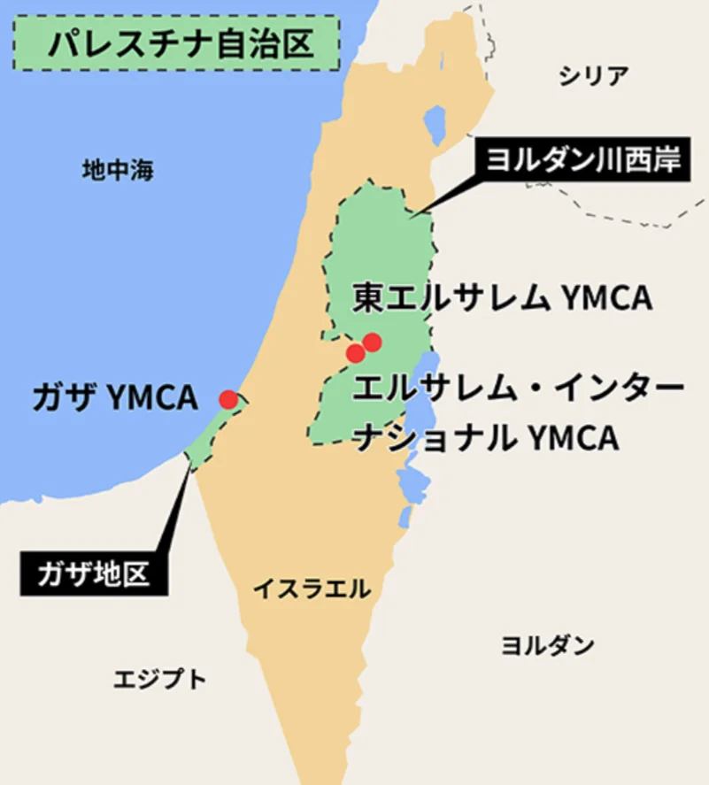

# 中東戦争とイスラエル・パレスチナ問題

- 第一次世界大戦中にイギリスはアラブ人・ユダヤ人・フランスの三者に対して相互矛盾する約束をしていました。**パレスチナ**（エルサレムを有する）を含む地域について、アラブ人には独立国家、ユダヤ人には「民族の郷土」、フランスには分割統治を約束するという、互いに矛盾する約束だったのです。この「**三枚舌外交**」が中東問題の出発点です。
- 以下はパレスチナ周辺の地図です。橙の部分がイスラエル（後述）、緑がパレスチナです。
    
    
    

- 1948年にユダヤ人が**イスラエル**を建国すると、翌日から周辺アラブ諸国との戦争が始まり、以後1973年まで四次にわたる**中東戦争**が起きました。
- 第三次中東戦争でイスラエルはヨルダン川西岸・ガザ地区・シナイ半島・ゴラン高原を占領し、パレスチナ人の難民問題が深刻化します。
- 第四次中東戦争ではアラブの産油国が石油輸出を制限する**オイルショック**が起き、日本でもトイレットペーパーの買い占め騒動が起きるほど世界経済に衝撃を与えました。
- 「誰の土地か」という問いは現在も解決しておらず、2023年の**ハマス**によるイスラエル攻撃とガザへの報復攻撃は、この問題が現在進行形であることを改めて示しています。
