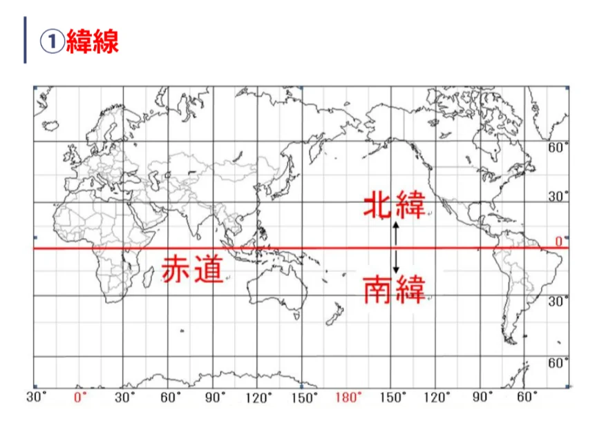
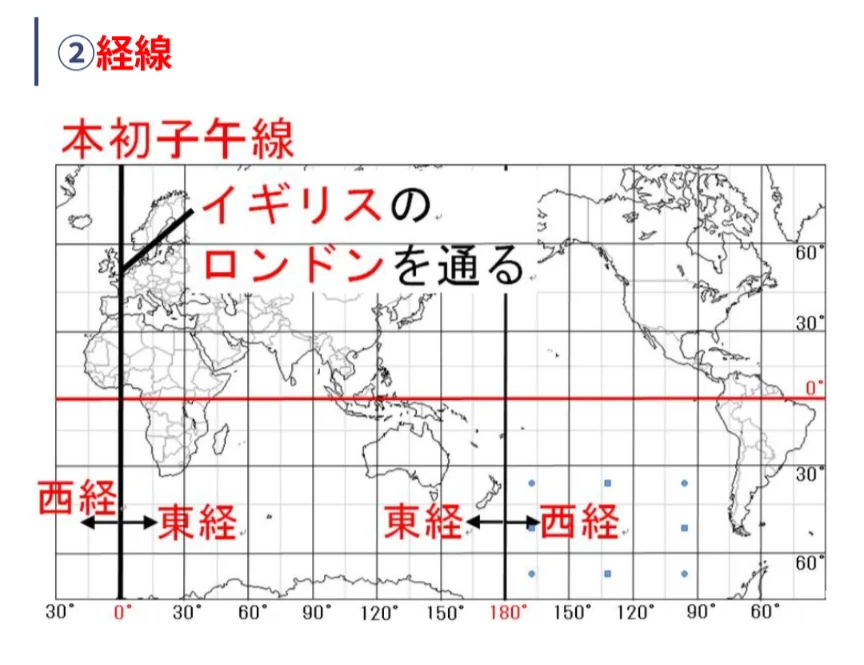
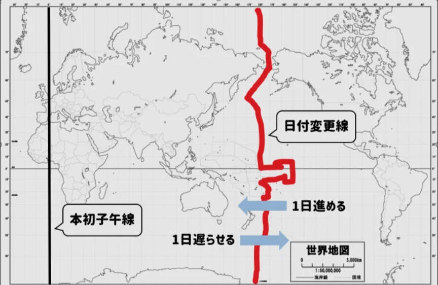

# 緯度・経度と時差

- 地球上の位置を表すために、**緯度**と経度という座標系があります。
- **緯度**は、**赤道**よりもどれだけ北（南）にあるか、を表す数値です。赤道を基準（0°）として、北極点が北緯90°、南極点が南緯90°です。
    
    
    

- **経度**は、イギリスのロンドン郊外にある**グリニッジ天文台**を基準として、それよりもどれだけ東（西）にあるか、表す数値です。基準（0°）を**本初子午線**と呼び、として、東西それぞれ180°まであります。
    
    
    

- 経度は**時差**と直結しています。地球は24時間で360°回転（**自転**）するので、1時間で15°動く計算になります。つまり、経度が15°東に行くと時刻が1時間進み、15°西に行くと1時間遅れます。
- 日本の標準時は**東経135°**を基準にしています。この135°の経線（**日本標準時子午線**）が通るのが兵庫県**明石市**です。
    - ロンドン（東経0°）との差は135÷15＝9時間なので、日本はロンドンより9時間進んでいます。日本が正午のとき、ロンドンは午前3時です。
- **日付変更線**は東経・西経180°付近に引かれた線で、この線を越えると日付が変わります。
    
    
    
