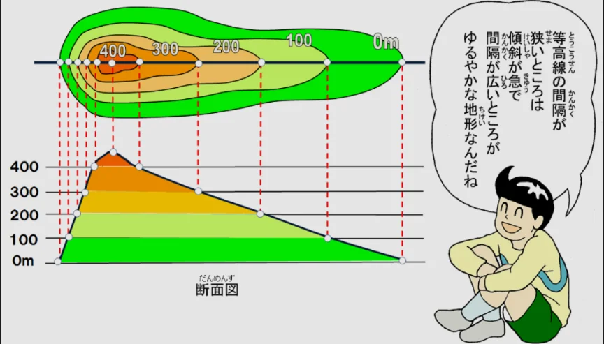
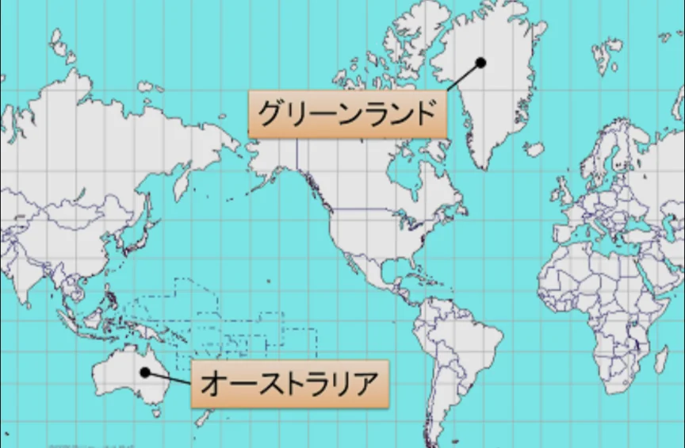

# 地図の読み方

- 地図には「実際の距離を何分の一に縮めているか」を示す**縮尺**があります。1/25000（2万5千分の1）の地図では、地図上の1cmが実際の250mに対応します。
- 地形図で最も重要な要素が**等高線**です。同じ標高の点を結んだ線で、等高線が密なほど急斜面、疎なほど緩やかな斜面を示します。
    
    
    

- よく使われる世界地図の図法は、**メルカトル図法**と呼ばれるものです。経線と緯線が直角に交わる格子状の地図で、世界地図として最もよく目にする形です。ただし、この図法には大きな歪みがあり、緯度が高い地域ほど面積が実際よりも大きく見えます。
- **グリーンランド**（下図）は世界最大の島（デンマーク領）で、メルカトル図法の地図ではアフリカ大陸と同じくらいの大きさに見えますが、実際の面積はアフリカの約14分の1しかありません。
    
    
    
