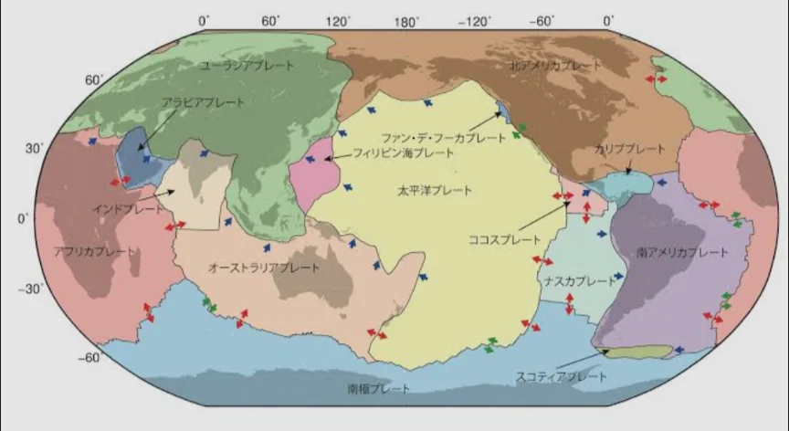
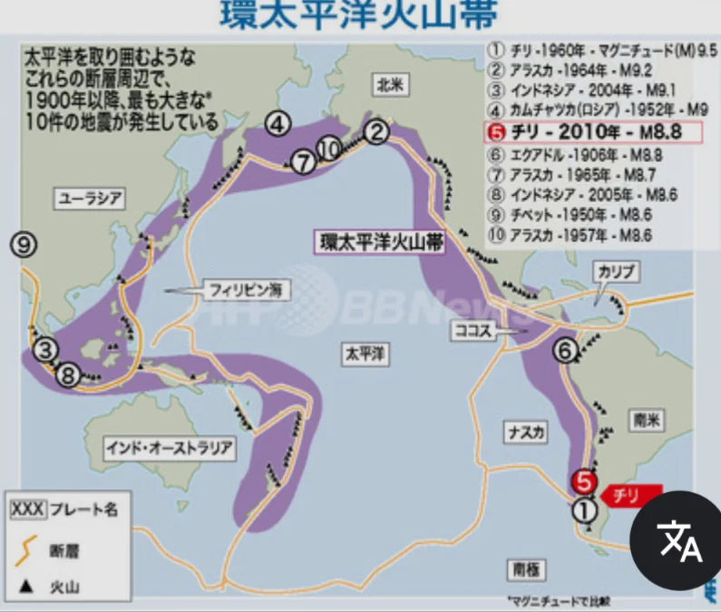
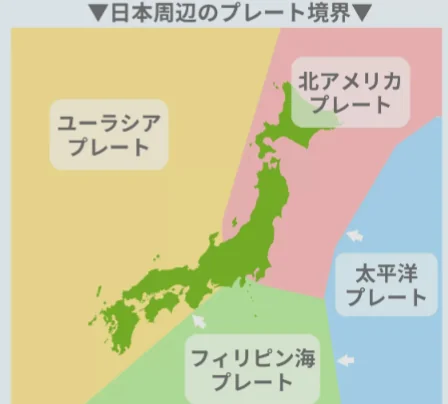

# プレートと地震・火山

- 地球の表面は十数枚の「**プレート**」と呼ばれる岩盤の板に分かれており、それぞれが年間数cmという非常にゆっくりとしたスピードで動いています。この考え方を「**プレートテクトニクス**」といいます。
    - 気象学者の**ウェゲナー**が、南アメリカ大陸の東海岸とアフリカ大陸の西海岸の形がぴったり合うことに気づき、「かつて一つの大陸だったのではないか」と主張したのがきっかけです。
    
    
    
- プレートとプレートがぶつかったり離れたりする場所に、地震や火山、山脈が集中します。**環太平洋火山帯**と呼ばれる太平洋を取り囲む地震・火山帯も、プレートの境界に一致しています。
    
    
    

- 日本列島は四つのプレートがぶつかる場所にあります。これが日本に地震・火山が多い理由です。
    - 北アメリカと太平洋の間で**東日本大震災**が起こりました。今後地震が起きると言われている**南海トラフ**はフィリピン海とユーラシアの間にあります。
    
    
    
