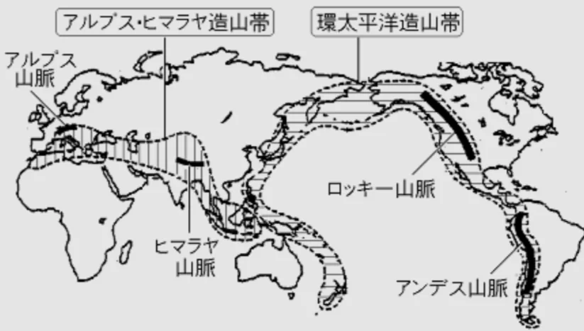
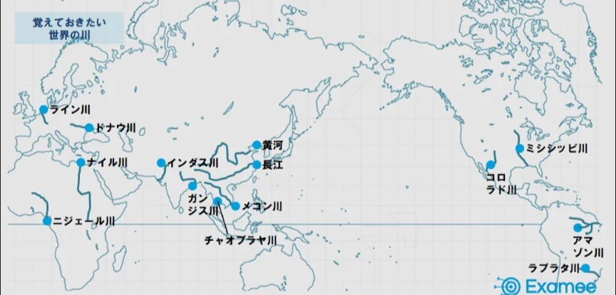

# 世界の山脈・河川・平野

- 世界の主要な山脈はプレートの衝突した場所に作られます。アジアの**ヒマラヤ**山脈（**エベレスト**は標高8849m）、ヨーロッパの**アルプス**山脈、南北アメリカ大陸の西側に連なる**ロッキー**山脈・**アンデス**山脈が代表例です。
    
    
    

- 大河川は文明の発祥地と深く結びついています。**ナイル川**はエジプト文明、**チグリス・ユーフラテス川**はメソポタミア文明、**インダス川**はインダス文明、**黄河**は中国文明の舞台でした。現代でも世界の大都市の多くは大河川沿いに位置しています。
    
    
    
- 世界最大の流量を誇る**アマゾン**川は南米のブラジルを流れ、その流量は世界の全河川の約20%を占めます。
    - 流域には地球上最大の熱帯雨林があり、「地球の肺」とも呼ばれますが、農地開発のための森林破壊が深刻な問題になっています。
- 平野は農業の舞台です。インドの**ガンジス平野**・中国の**華北平原**・アメリカの**グレートプレーンズ**・ウクライナの**黒土地帯**など、世界の主要穀倉地帯は大平野と重なります。
