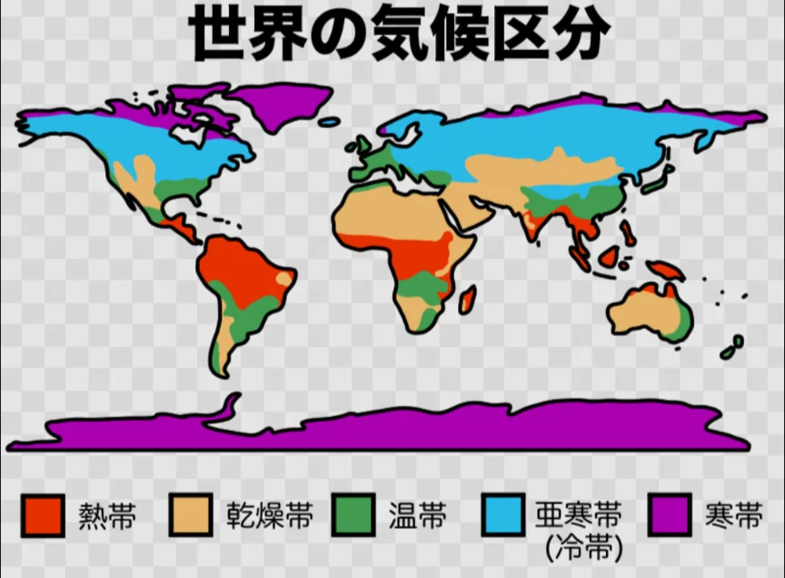

# 気候帯の分類

- 気候を体系的に分類したのが気候学者の**ケッペン**で、彼の区分が現在も世界標準として使われています。大きく五つの気候帯に分かれます。
    
    
    
- **熱帯**（A）は赤道付近の気候で、一年中気温が高く雨が多い**熱帯雨林**と、雨季と乾季が分かれる**サバンナ**があります。
    - 東南アジア・中央アフリカ・アマゾン流域が代表的です。
- **乾燥帯**（B）は降水量が少ない気候で、**砂漠**と**ステップ**（草原）に分かれます。
    - サハラ砂漠・アラビア半島・オーストラリア内陸部などです。
- **温帯**（C）は四季がある比較的過ごしやすい気候で、日本の多くもここに属します。
    - 日本・中国東部・ヨーロッパ・北米東部などが温帯です。
- **冷帯**（D）はロシア・カナダ・北欧など高緯度の大陸内部で、冬が非常に厳しい気候です。**針葉樹林**（タイガ）が広がります。
- **寒帯**（E）は北極・南極周辺の極端に寒い気候です。
