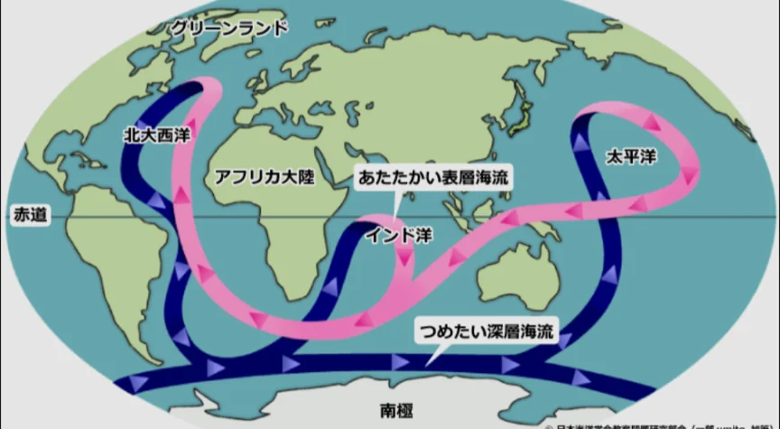
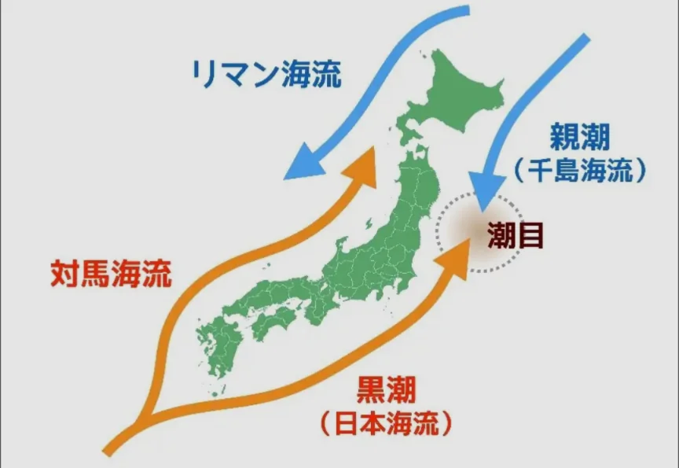

# 海流と気候

- **暖流**は低緯度から高緯度へ温かい海水を運び、沿岸の気候を温暖にします。**寒流**は逆に沿岸を冷涼・乾燥させます。
    
    
    
- 最も有名な例がヨーロッパを温める**北大西洋海流**です。ロンドンは北海道より高緯度にあるにもかかわらず、冬でも比較的温暖なのはこの海流のおかげです。
- 日本近海にも重要な海流があります。**黒潮**（日本海流）は太平洋を北上する暖流です。**親潮**（千島海流）は北から南下する寒流です。暖流と寒流がぶつかる場所（**潮目**）は栄養豊富で、**三陸沖**が世界有数の漁場になっているのはこのためです。
    
    
    
