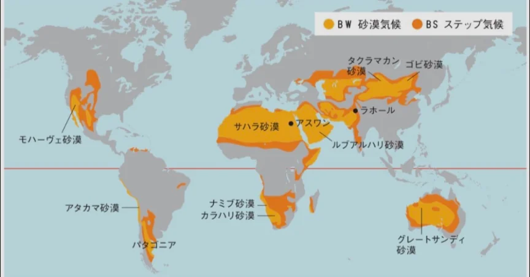

# 砂漠

- **砂漠**の定義は「景観」ではなく「降水量」です。年間降水量が250mm以下の地域を砂漠と呼びます。
    - 砂ではなく、岩石や砂利ばかりの景観でも、降水量が少なければ砂漠と呼びます。
    
    
    
- 砂漠ができる理由はいくつかあります。最も典型的なのが亜熱帯高圧帯による砂漠です。北緯・南緯20〜30°付近には高気圧があり、雨をほとんど降らせないため、砂漠ができます。
    - **サハラ**砂漠・アラビア砂漠・オーストラリアの砂漠はどれも緯度が近く、この仕組みでできています。
- 大陸の内陸部にできる砂漠もあります。海から遠く、水分を含んだ風が届かないためです。
    - 中央アジアの**ゴビ**砂漠がこの例です。
- 山脈の風下側にできる砂漠もあります。山を越えた空気は途中で雨を降らせるために水分を失い、乾燥した風が吹き下ろします（**フェーン現象**）。
    - 南米の**アタカマ**砂漠がこの例です。
- 砂漠は増えています。過剰な放牧や農地開発による「砂漠化」は、特にサハラ砂漠の南縁部（サヘル地帯）やアジアで深刻な問題です。
