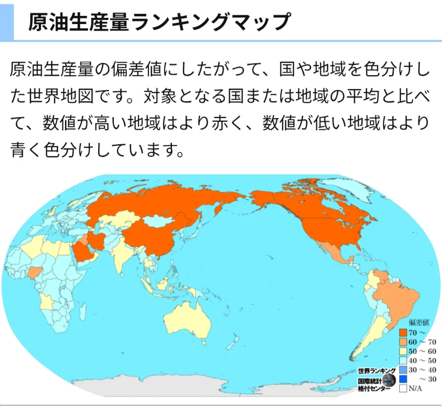

# 石油・天然ガスの分布

- 現代文明を支えるエネルギーの中心が**石油**と**天然ガス**です。しかしこれらの資源は特定の地域に偏在しています。
    
    
    

- 世界の確認埋蔵量の約半分が**中東**（サウジアラビア・イラク・イラン・クウェート・UAE）に集中しています。
    - 産油国が集まってつくる組織が**OPEC**（石油輸出国機構）です。加盟国が協調して生産量を調整することで石油価格に影響を与えます。
- 1970年代に中東の産油国が石油の輸出を制限した**オイルショック**では、日本でもトイレットペーパーの買い占め騒動が起きるほど経済が混乱しました。
    - 「石油を持つ国が持たない国を揺さぶれる」という構造が、現代の国際政治の重要な軸の一つになっています。
- 近年はロシア・アメリカ・カナダなどの生産量も増えており、中東一極集中の構図は変わりつつあります。また、**シェール革命**（石油・ガスを採掘する新しい技術）によりアメリカが世界最大の産油国になったことは、国際政治のパワーバランスにも影響を与えています。
