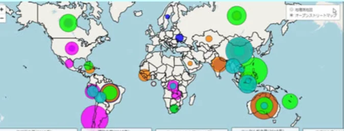

# 鉱物資源とレアメタル

- 石油以外にも、現代の産業を支える鉱物資源は特定の地域に偏在しています。
- 以下は主な鉱物資源の生産量を表すマップです。アメリカ、中国、ロシア、オーストラリア、アフリカの一部に偏っており、ヨーロッパや日本ではほとんど生産量がありません。
    
    
    

- **鉄鉱石**はオーストラリア・ブラジル・中国が主要産出国で、日本はその大半をオーストラリアとブラジルから輸入しています。
- **銅**はチリが世界最大の産出国で、南米の国々の経済に大きな影響を与えています。
- 近年特に重要性が増しているのが**レアメタル**（希少金属）です。スマートフォン・電気自動車・再生可能エネルギー機器などのハイテク製品に欠かせない金属で、リチウム・コバルト・ニッケル・ネオジムなどが含まれます。
    - **リチウム**はアンデス山脈周辺に集中しています。
    - **コバルト**はコンゴ民主共和国が世界生産の約70%を占めます。
    - 「スマホの中の鉱物がコンゴの紛争を資金援助している」という問題はここから来ています。紛争地域で採掘された鉱物が国際市場に流れ込むことで、武装勢力の資金源になる「紛争鉱物」問題は、消費者も無関係ではない問題です。
