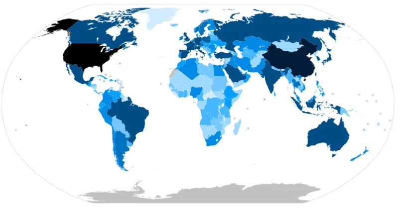

# 経済格差

- なぜ豊かな国と貧しい国があるのでしょうか。要因は複合的で、植民地支配の歴史・地理的条件（海へのアクセス・気候・資源）・制度・教育水準などが絡み合っています。
- 以下は各国を**GDP**（国内総生産）の大小によって色分けした地図です。色が濃いほど、GDPが大きいことを表します。
    
    
    

- 単純に「資源があるから豊か」とも言えず、石油で潤うはずのナイジェリアが貧困から抜け出せない「**資源の呪い**」と呼ばれる現象もあります。資源収入が一部の権力者に集中し、腐敗や紛争を生むパターンです。
- 先進国と途上国の関係を「**南北問題**」と呼びます。豊かな先進国が北半球に多く、貧しい途上国が南半球に多いことから来た呼び方です。
    - 1980年代以降に発展したアジア**NIEs**（韓国・台湾・シンガポール・香港）や、2000年代以降に発展した**BRICS**（ブラジル、ロシア、インド、中国、南アフリカ）などにより、「南北」の構図は複雑化しています。
- 日本は資源をほぼ輸入に頼りながら、製造業で付加価値をつけて輸出するモデルで経済大国になりました。資源がなくても豊かになれることを示した例として、よく挙げられます。
