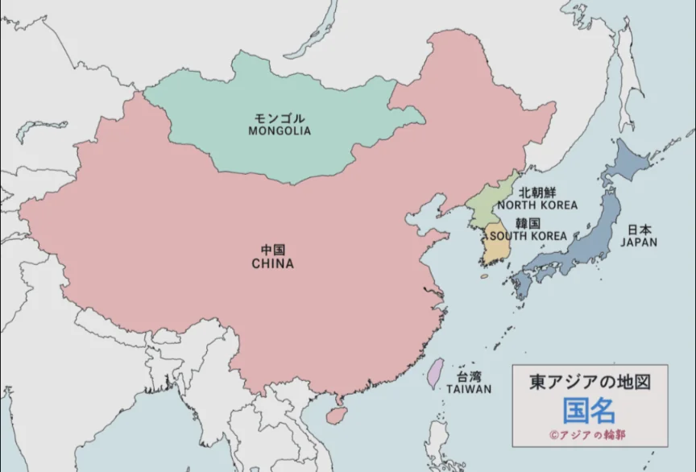
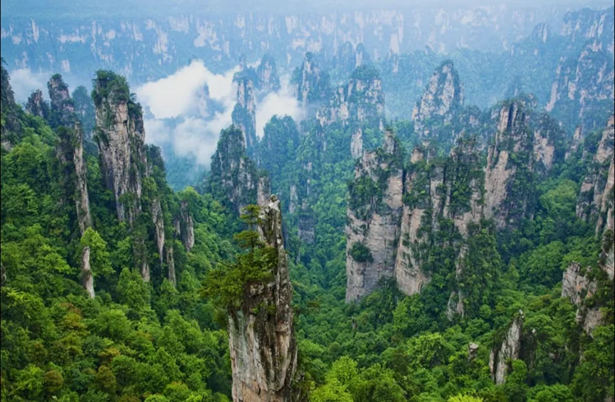
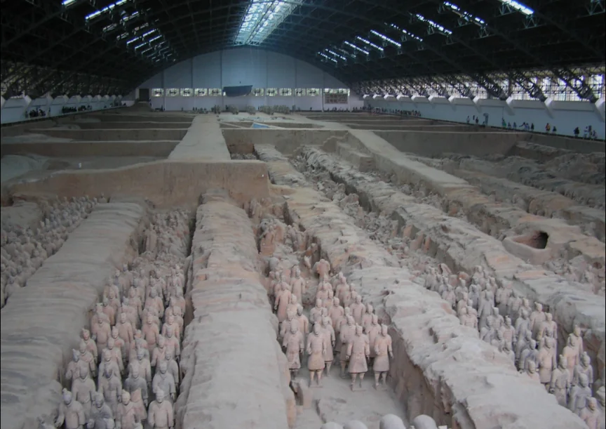
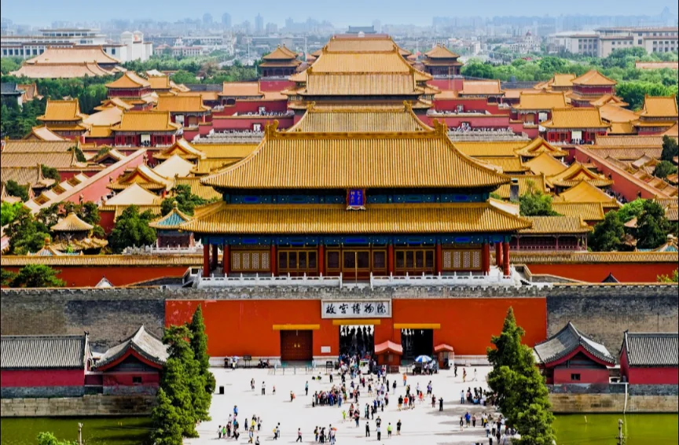
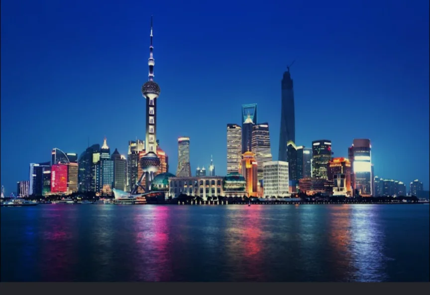
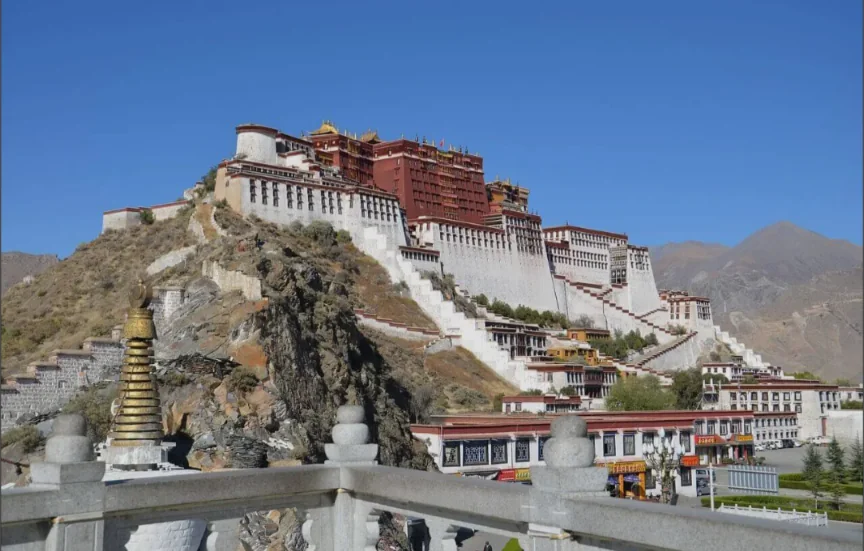
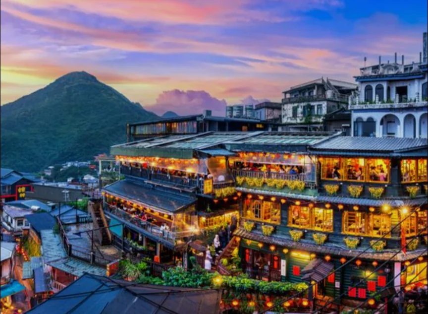

# 東アジア

- **東アジア**は日本・中国・韓国・台湾・モンゴルからなる地域で、漢字文化・儒教思想など共通する文化的背景を持ちます。
    
    
    

- **中国**は、面積は世界4位、人口約14億人（世界2位）という巨大な国家です。広大な国土には砂漠・草原・熱帯雨林・高原・平野と多様な地形・気候が共存しています。
    - 中国の経済成長は「**世界の工場**」として製造業を担うことで達成されましたが、近年は技術・軍事でも存在感を増しており、アメリカとの覇権競争が21世紀の国際政治の最大テーマになっています。
    - **観光地**
        
        
        
        万里の長城
        
        
        
        武陵源
        
        
        
        兵馬俑
        
        
        
        紫禁城
        
        
        
        上海
        
        
        
        ポタラ宮
        
- **韓国**は朝鮮半島の南半分を占める国で、面積は日本の約4分の1、人口は約5200万人です。1960年代には日本の**ODA**（政府開発援助）も受ける貧しい国でしたが、半導体・造船・自動車・エレクトロニクスなどの産業を育てて急速に発展し、現在は先進国の一員です。
- **台湾**は中国大陸から約180km離れた島で、面積は九州とほぼ同じです。**半導体の製造**で世界最重要の地位を占め、世界の半導体の約60%が台湾で製造されています。
    - 中国は台湾を「自国の一部」と主張しており、台湾海峡の緊張は現代の地政学上の最大のホットスポットの一つです。
    - **観光地**
        
        
        
        九份
        
