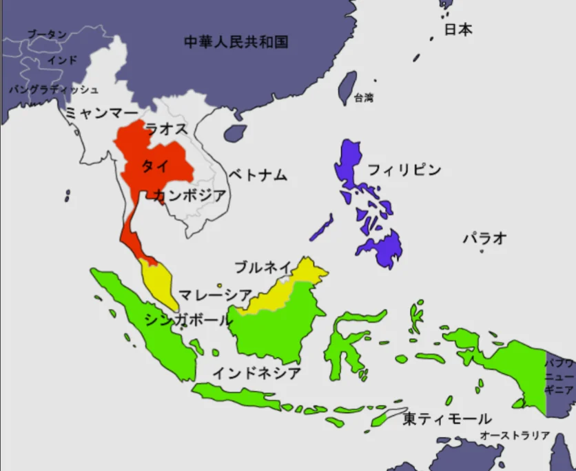
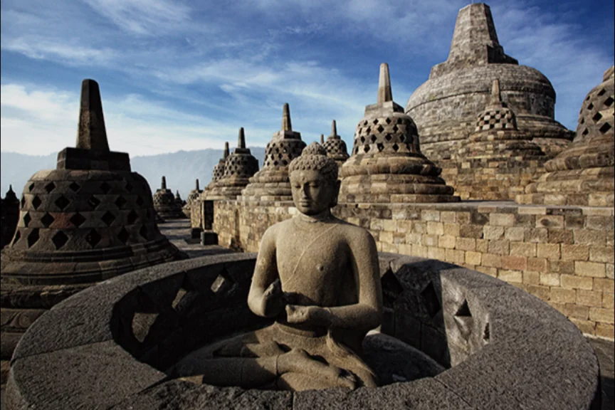
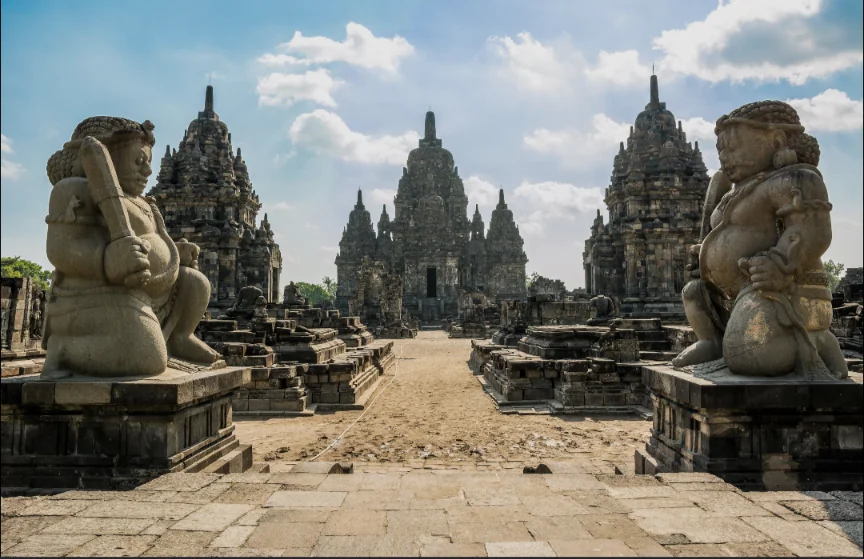
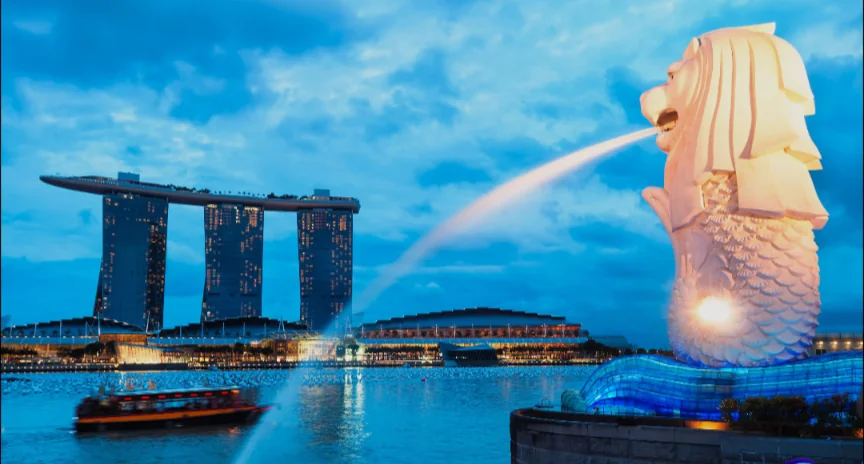
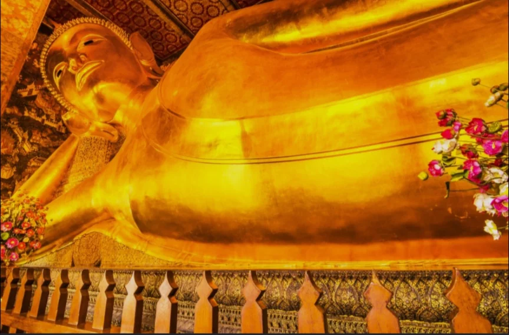
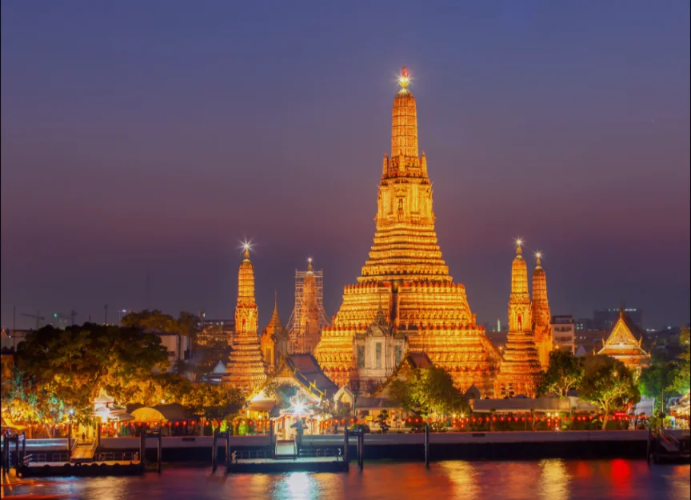
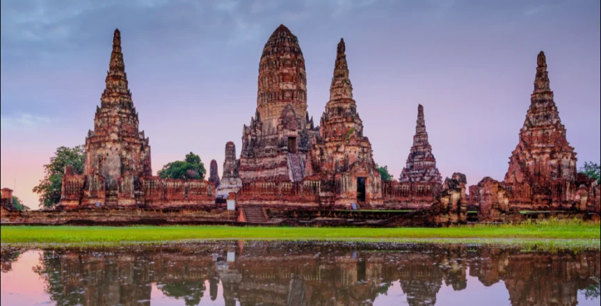
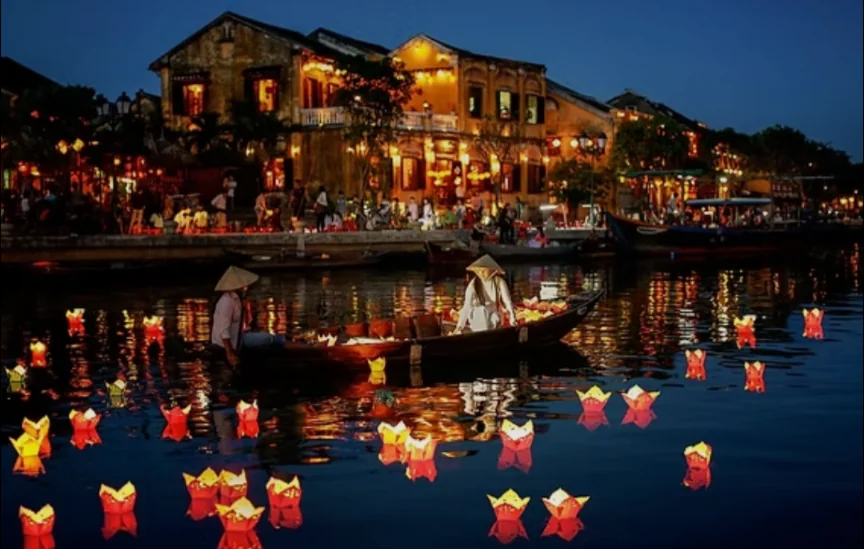

# 東南アジア

- **東南アジア**は中国とインドという二大文明の間に位置し、歴史的にその両方の影響を受けながら独自の文化を育ててきた地域です。そのうちの11カ国が**ASEAN**（東南アジア諸国連合）を形成しています。
    
    
    

- 地理的に**大陸部**（タイ・ベトナム・ミャンマーなど）と**島嶼部**（インドネシア・フィリピン・マレーシアの一部など）に分かれます。
- 大陸部は**メコン川**など大河川が流れる農業地帯で、米の生産が盛んです。島嶼部は火山が多く、インドネシアは世界最多の活火山を持つ国の一つです。
- **インドネシア**は人口約2億7000万人（世界4位）を擁する大国で、1万7000以上の島からなります。石油やニッケルなど資源も豊富です。
    - **観光地**
        
        
        
        ボロブドゥール（ジャワ島）
        
        
        
        プランバナン寺院
        
- **シンガポール**は面積が東京23区とほぼ同じという極小の都市国家ながら、港湾・金融・物流の拠点として一人当たりGDPが日本を大きく上回る豊かな国です。
    - **観光地**
        
        
        
        マリーナベイサンズとマーライオン
        
    
- **その他の国の観光地**
    
    
    
    ワット・ポー（タイ）
    
    
    
    ワット・アルン（タイ）
    
    
    
    アユタヤ（タイ）
    
    
    
    ハノイ（ベトナム）
    
