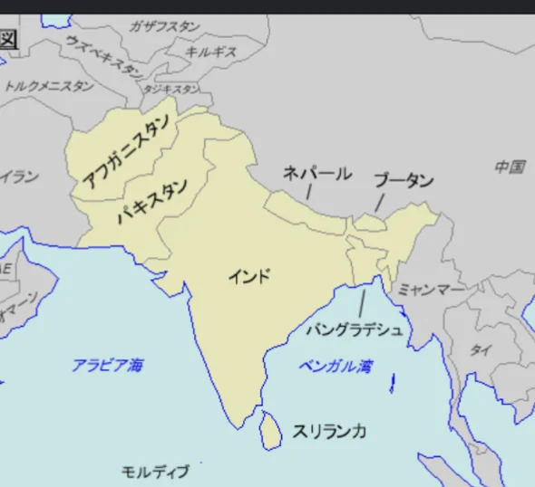
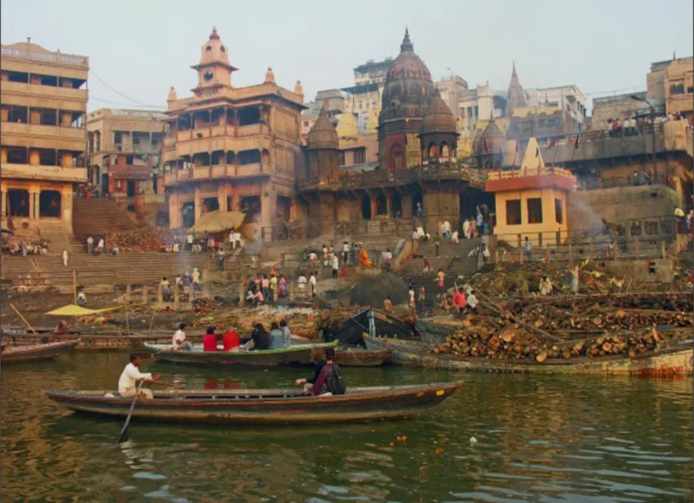
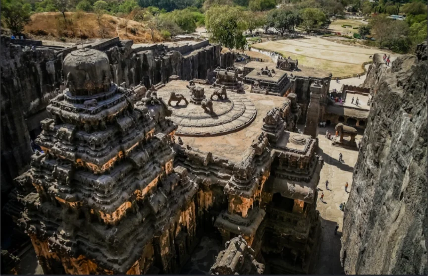

# 南アジア

- **南アジア**はヒマラヤ山脈を北の壁として、インドとその周辺の国々からなる地域です。
    
    
    

- **インド**は2023年に中国を抜いて世界最多人口の国になりました。面積は日本の約9倍、人口は約14億3000万人です。北部にはガンジス平野という広大な農業地帯があり、南部は**デカン高原**が広がります。気候は**モンスーン**（後述）の影響を強く受け、雨季と乾季が明確に分かれます。
    - 話されている言語は数百に及びます。宗教も**ヒンドゥー教**・イスラム教・シク教・仏教・キリスト教などが共存しています。
    - IT産業の発展が目覚ましく、バンガロールは「**インドのシリコンバレー**」と呼ばれます。ただし都市と農村、富裕層と貧困層の格差は依然として大きいです。
    - **観光地**
        
        
        
        タージ・マハル
        
        
        
        ベナレス
        
        
        
        エローラ遺跡
        
- **パキスタン**と**バングラデシュ**は1947年のインド独立時にイギリス領インドから分離したイスラム教国家です。
    - **パキスタン**はインダス川流域に広がる国で、**核兵器**を保有し、インドとの間に**カシミール問題**という未解決の領土紛争を抱えています。
    - **バングラデシュ**は洪水と海面上昇の脅威に常にさらされています。
