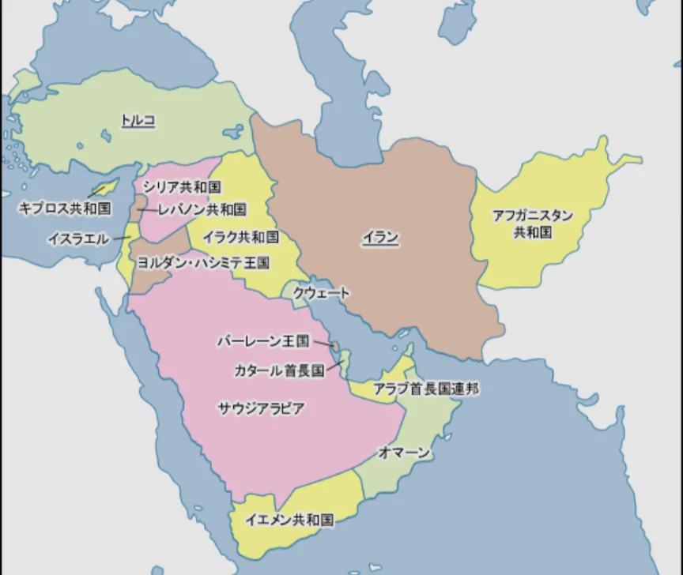
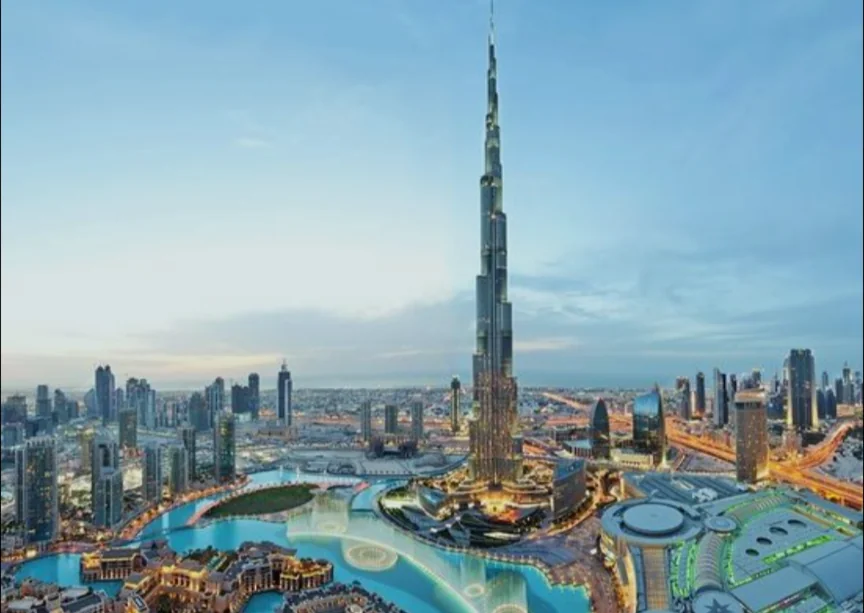
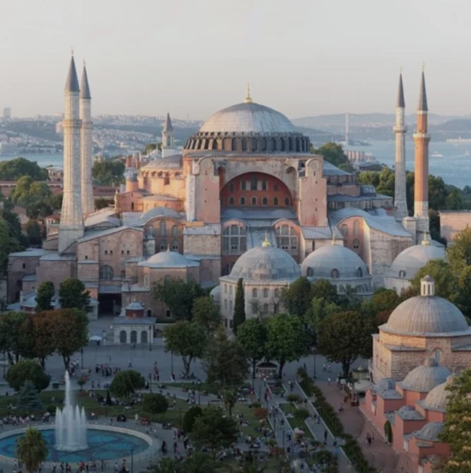
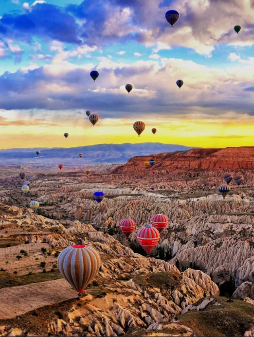

# 中東・西アジア

- **中東**は、一般に**アラビア半島**周辺の地域を指します。
    
    
    

- この地域の最大の地理的特徴は**石油**と乾燥した気候です。アラビア半島のほとんどは砂漠で、降水量が極めて少ないため農業が難しく、石油収入なしには成立しない国が多くあります。
- **サウジアラビア**・**UAE**（アラブ首長国連邦）・**クウェート**などの産油国は石油収入で近代的なインフラを整備し、**ドバイ**のような砂漠の中の超近代都市を作り上げました。
    
    
    
- **イスラエル・パレスチナ問題**はこの地域の中心的な紛争です。ユダヤ人が1948年にイスラエルを建国した際、もともとそこに住んでいたパレスチナ人が土地を追われました。ユダヤ教・イスラム教・キリスト教の三宗教の聖地エルサレムをめぐる対立も絡み、解決の糸口が見えないまま現在に至っています。
- **イラン**と**サウジアラビア**はイスラム世界の二大勢力として対立しています。イランはイスラム教シーア派、サウジアラビアはスンニ派を代表し、この宗派対立は中東各地の紛争に影響を与えています。
- **トルコ**は、**NATO**（北大西洋条約機構。ヨーロッパの国が主に加盟。）加盟国でありながらイスラム世界にも属するという独特の立場で、ヨーロッパとアジアを結ぶ**ボスポラス海峡**を押さえる地政学的要衝です。
    - **観光地**
        
        
        
        アヤソフィア
        
        
        
        カッパドキア
        
