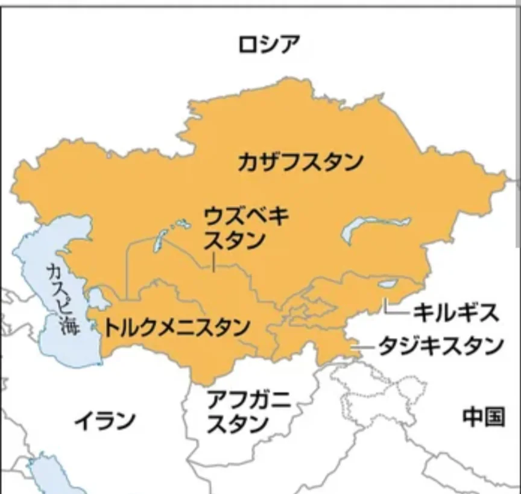

# 中央アジア

- **中央アジア**は、いずれも旧ソビエト連邦の構成国で、1991年のソ連崩壊後に独立しました。周辺にある**カスピ海**は世界最大の「湖」です。
    
    
    

- この地域の最大の地理的特徴は「海のない内陸国」であることです。海へのアクセスがないことは貿易上の大きな不利で、物を輸出入するためにいくつもの国を通過しなければなりません。物流コストが高く、経済発展の障壁になっています。
- かつては、**シルクロード**の幹線が通り、東西交易の要衝として栄えました。現在でも中央アジアは中国・ロシア・ヨーロッパ・中東を結ぶ回廊として地政学的に重要で、中国の「**一帯一路**」構想の核心地域でもあります。
- **カザフスタン**は、石油・天然ガス・ウランなどの資源が豊富です。
