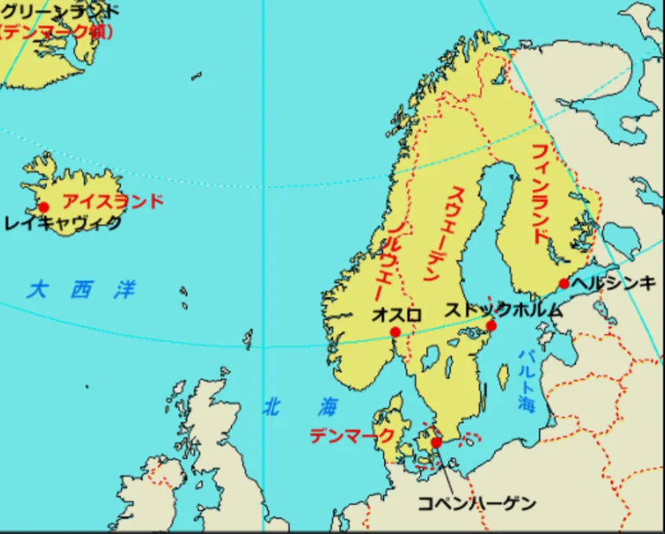
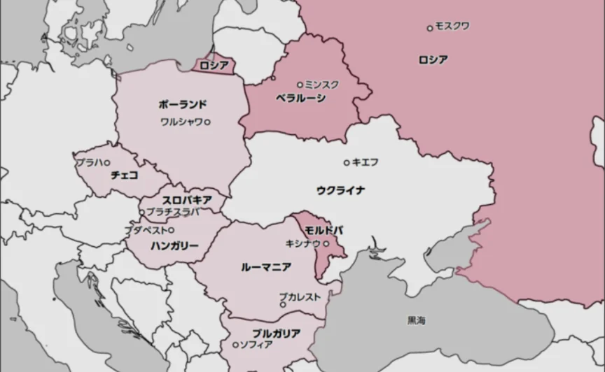
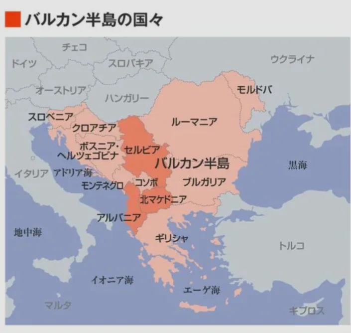

# 北・東ヨーロッパ

- **北ヨーロッパ**は、人口は合わせて約2700万人と少ないですが、社会福祉・教育・男女平等・幸福度などの国際ランキングで常に上位を占める国々です。
    
    
    

- **東ヨーロッパ**は、旧社会主義圏の国々が並びます。1989年の冷戦終結後に相次いでEUに加盟し、西欧からの投資を受けて経済発展してきました。
    
    
    

- **バルカン半島**は複雑な民族・宗教の混在地帯で、もともとは**ユーゴスラビア**という1つの国でしたが、さまざまな民族や言語・文化を持っていたため、1990年代のユーゴスラビア解体に伴い、激しい紛争が起きました。「**火薬庫**」と呼ばれた歴史は現在も地域の政治的不安定さに影を落としています。
    
    
    
