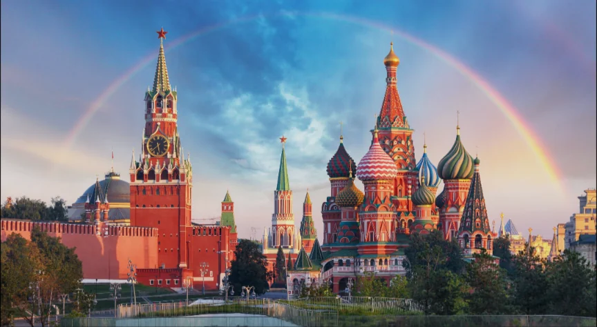
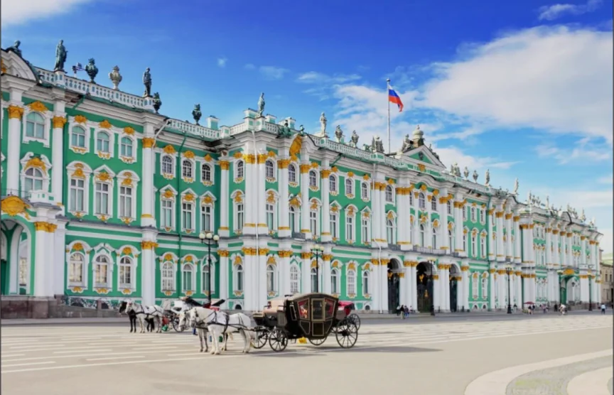

# ロシアの地理

- **ロシア**は面積約1710万km²（世界1位）で、日本の約45倍という想像を絶する広さを持ちます。
- 国土の大部分は**永久凍土**（一年中凍ったままの土地）が広がります。しか、しこの広大な土地には石油・天然ガス・石炭・鉄鉱石・ダイヤモンドなど膨大な資源が眠っており、ロシアが「**資源大国**」として国際的な影響力を持つ基盤になっています。
- ロシアは歴史的に「暖かい海への出口」を求め続けてきた国です。北側は凍る海（北極海）、東側は太平洋の辺境、南側は山脈や中央アジアの砂漠が障壁となっており、年中使える港（**不凍港**）を確保することが長年の地政学的課題でした。ウクライナへの侵攻もこの文脈（黒海・クリミア半島へのアクセス）で理解できる部分があります。
- **観光地**
    
    
    
    赤の広場とクレムリン
    
    
    
    エルミタージュ美術館
    
