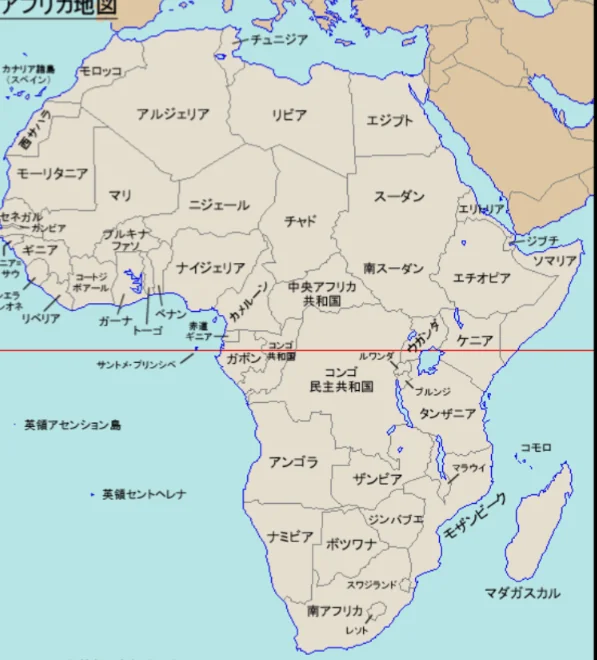

# アフリカの地理と課題

- **アフリカ大陸**の面積は約3030万km²で、ユーラシア・南北アメリカ・ヨーロッパ・日本を合わせても収まるほどの広さです。
    
    
    

- 気候は赤道を中心に対称的に並んでいます。赤道付近に熱帯雨、その外側に**サバンナ**（草原とまばらな樹木）、さらに外側に**砂漠**（サハラ砂漠など）という帯状の構造になっています。
- アフリカが抱える最大の地理的問題の一つが「植民地時代に引かれた直線の国境」です。19世紀後半にヨーロッパ列強がアフリカを分割した際、民族・言語・文化の分布を無視して定規で引いたような直線の国境が引かれました。
    - その結果、一つの民族が複数の国に分断されたり、対立する民族が同じ国に押し込められたりしました。この歪みが現在も続く民族紛争や内戦の根本原因の一つです。
- 資源は豊富です。コンゴのコバルト・南アフリカのダイヤモンド・ナイジェリアの石油・ザンビアの銅……しかし資源収入が汚職や紛争に転化する「**資源の呪い**」の問題も深刻です。
    - 近年は人口増加と経済成長が著しく、「アフリカの世紀」という言葉も聞かれるようになっています。
