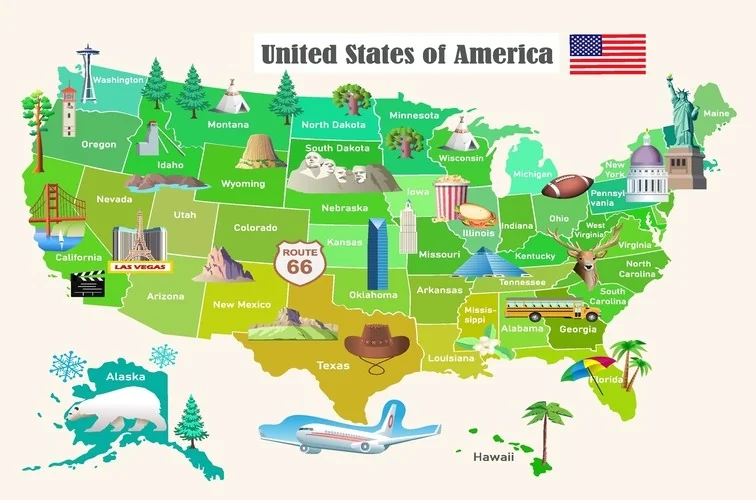
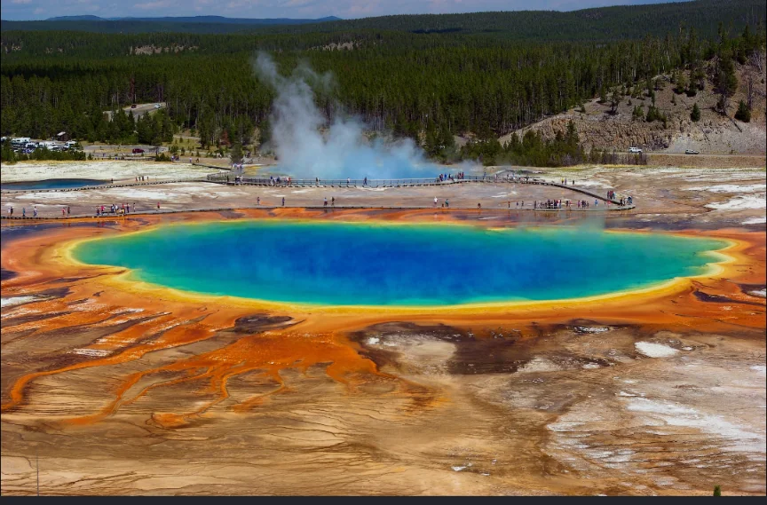
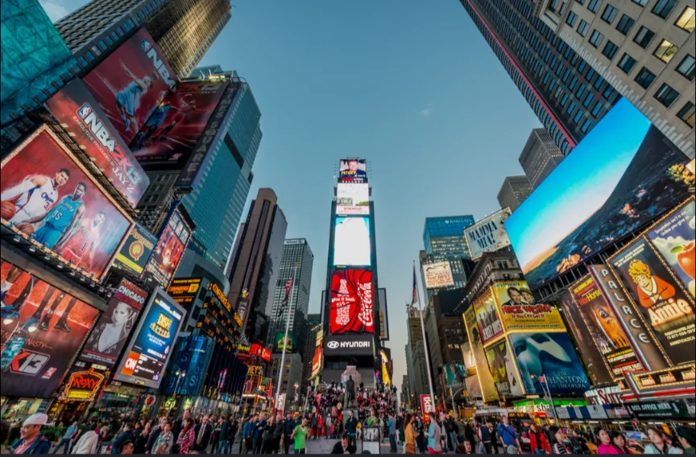
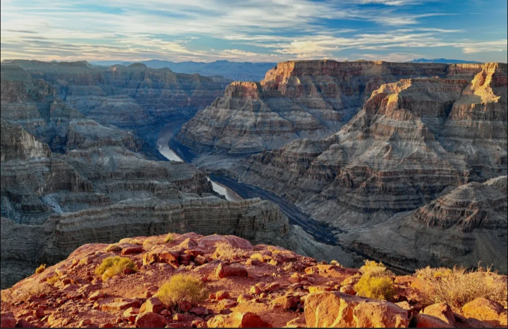
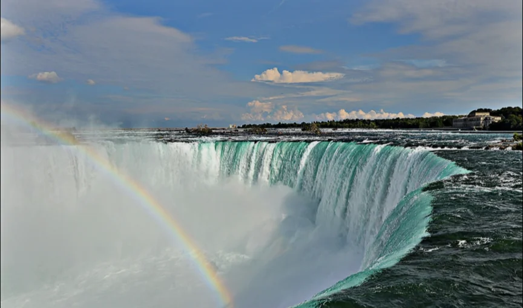
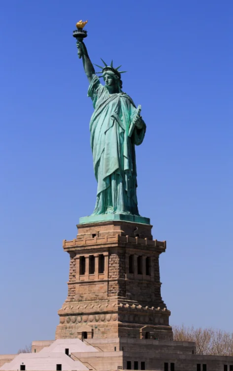

# アメリカ合衆国

- **アメリカ**は、面積は世界3位、人口も世界3位、GDPは世界1位という超大国です。
- 地形は大きく三つに分かれます。西部の**ロッキー**山脈、中央部の**グレートプレーンズ**（大平原）、東部の**アパラチア**山脈とそれ以東の平野です。
- 50州それぞれに独自の性格があります。
    - **テキサス**州は石油・農業・IT産業が混在
    - **カリフォルニア**州は、**シリコンバレー**のIT産業と映画産業（ハリウッド）・農業を抱える
    - **ニューヨーク**州は世界金融の中心**ウォール街**を持ち、多様な移民が共存するアメリカの縮図のような場所
    
    
    
- **観光地**
    
    
    
    イエローストーン国立公園
    
    
    
    タイムズスクエア
    
    
    
    グランドキャニオン
    
    
    
    ラスベガス
    
    
    
    ナイアガラの滝（世界三大瀑布）
    
    
    
    自由の女神
    
