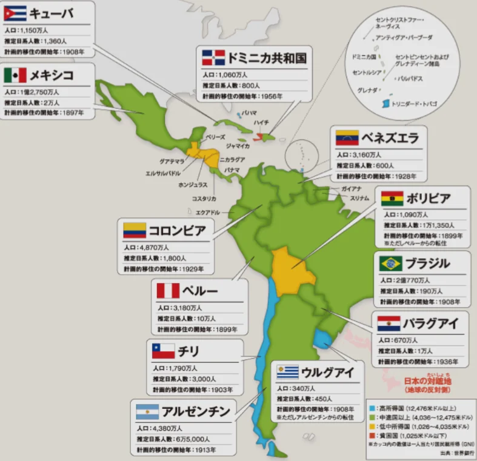
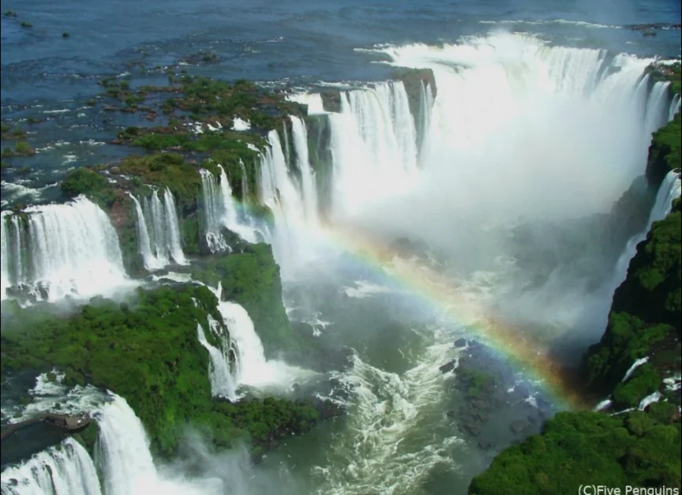
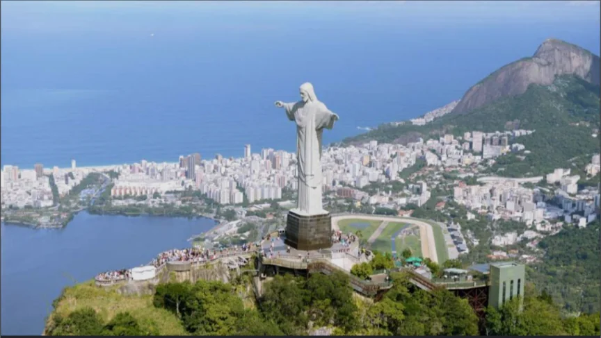
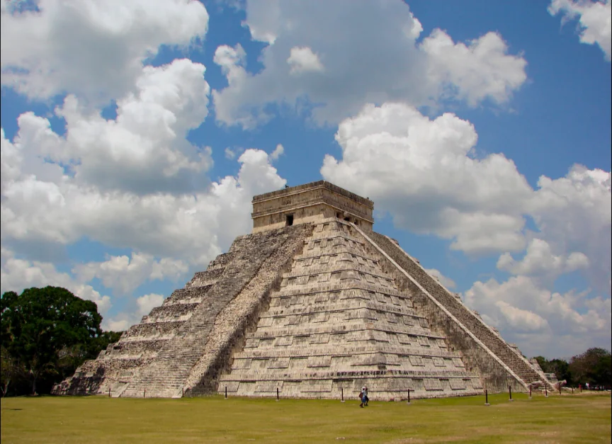
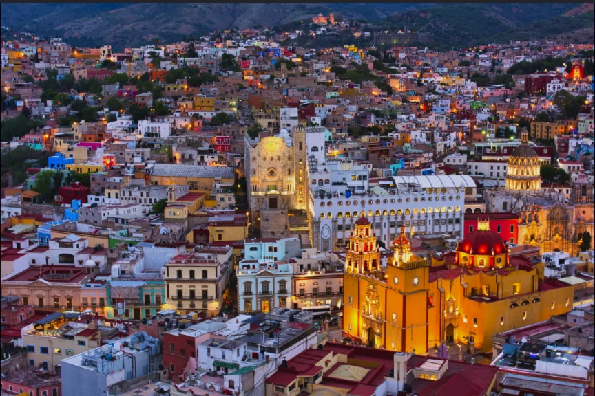
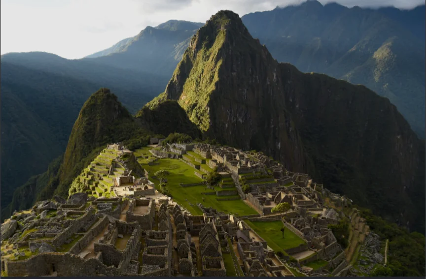

# 中南米

- **中南米**はポルトガル語圏（ブラジル）とスペイン語圏（その他多くの国）に大別されます。
    
    
    

- **ブラジル**は南米最大の国です。**アマゾン**川流域に地球最大の熱帯雨林を抱え、大豆・砂糖・コーヒー・牛肉の世界的な生産国でもあります。
    - **観光地**
        
        
        
        リオのカーニバル
        
        
        
        イグアスの滝（世界三大瀑布）
        
        
        
        コルコバードの丘
        
- **メキシコ**は、アメリカとの長い国境を接しています。アメリカ向けの製造業が盛んで、自動車・電機製品の組み立てを担う工場地帯が国境沿いに並びます。移民問題でもアメリカとの関係が常に焦点になります。
    - **観光地**
        
        
        
        チチェン・イッツァ
        
        
        
        メキシコシティ
        
- **その他の国の観光地**
    
    
    
    ウユニ塩湖（ボリビア）
    
    
    
    ナスカの地上絵（ペルー）
    
    
    
    マチュピチュ（ペルー）
    
    
    
    レインボーマウンテン（ペルー）
    
