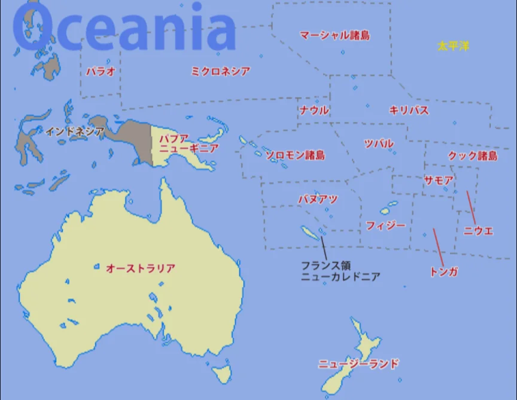
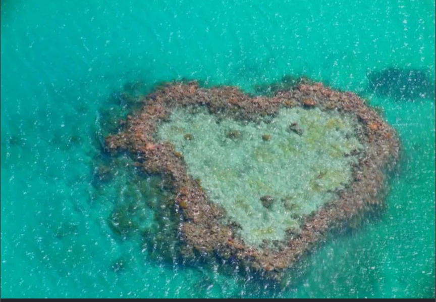
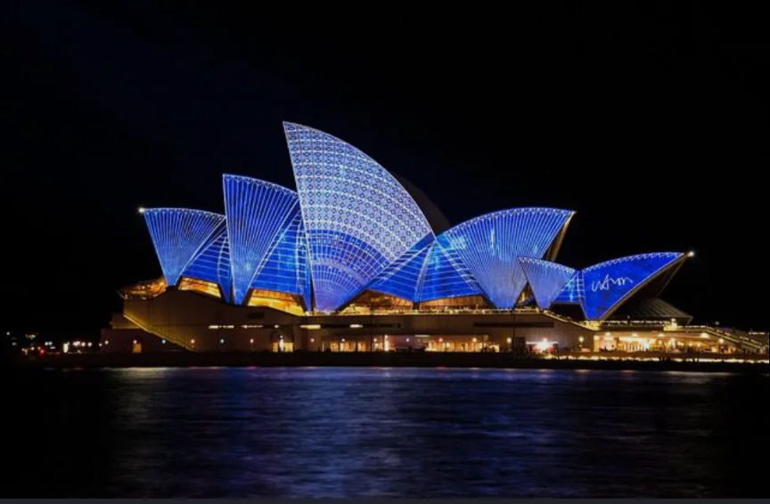
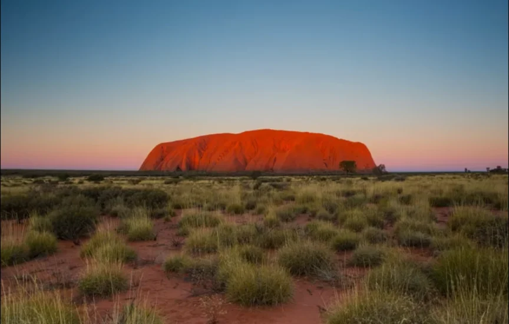

# オセアニア

- **オセアニア**はオーストラリア・ニュージーランドと太平洋に散らばる島々からなる地域です。
    
    
    

- **オーストラリア**は国土の約70%が乾燥・半乾燥地帯で、シドニー・メルボルン・ブリスベン・パースという主要都市はすべて海岸に位置しています。
    - 内陸部は広大な乾燥地帯で、**有袋類**（カンガルー・コアラ・ウォンバット）など、他の大陸とは全く異なる独自の生態系を持ちます。
    - **観光地**
        
        
        
        ハート・リーフ（グレートバリアリーフにあるハート形のサンゴ礁）
        
        
        
        コアラ
        
        
        
        シドニー・オペラハウス
        
        
        
        エアーズ・ロック（ウルル）
        
- **ニュージーランド**は、火山・温泉地帯や、アルプスに似た山岳地帯（サザンアルプス）、**フィヨルド**（氷河に侵食されてできた地形）などの地形で有名です。
    - 羊の数が人口の約6倍という農業・牧畜国で、映画「ロード・オブ・ザ・リング」の撮影地として有名です。
- 太平洋の島々の多くは海抜が低く、地球温暖化による海面上昇で水没の危機にさらされています。
