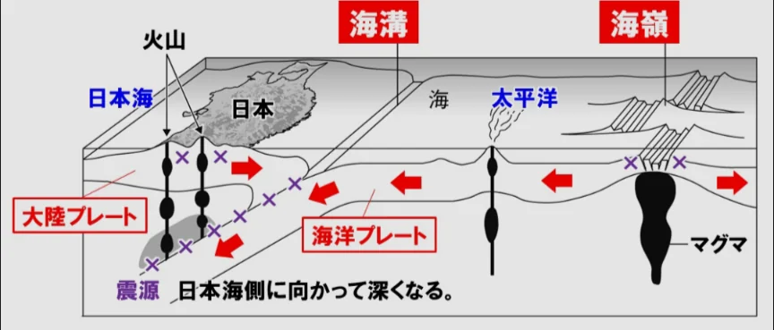

# 日本列島の成り立ち

- **日本列島**は四つのプレートがぶつかり合う場所に位置しています。プレートが沈み込む場所（**海溝**）には地震が集中し、沈み込んだプレートが溶けてマグマとなって噴出する場所に火山ができます。
    
    
    
- 日本には約110の**活火山**があり、これは世界全体の約7%に相当します。富士山も活火山で、最後の噴火は1707年（**宝永噴火**）です。
