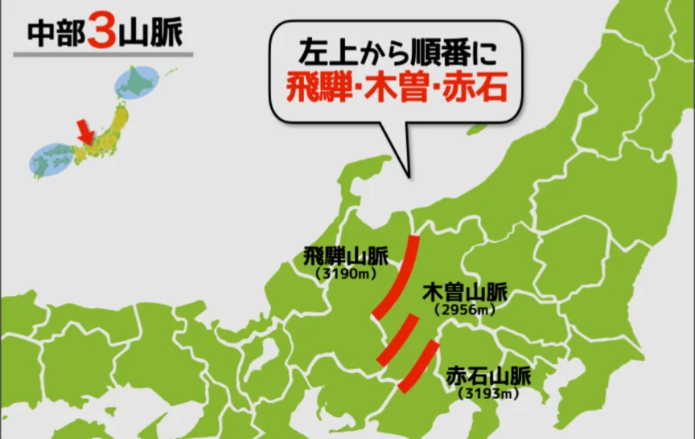

# 日本の山地・平野・河川

- 日本の国土の約73%は山地・丘陵地です。平野は全体の約13%しかありません。
- 日本の中央部には「日本の屋根」と呼ばれる飛騨山脈・木曽山脈・赤石山脈（合わせて**日本アルプス**）がそびえています。
    
    
    

- 主要な平野はいずれも川が運んだ土砂が堆積したもの（沖積平野）です。
    - **関東平野**は面積約1万7000km²と日本最大の平野です。その他、**濃尾平野**（名古屋）・**大阪平野**（大阪）も大都市圏の基盤となる平野です。
- 日本の河川は長さが短く、勾配が急という特徴があります。**信濃川**（全長367km）が日本最長です。
