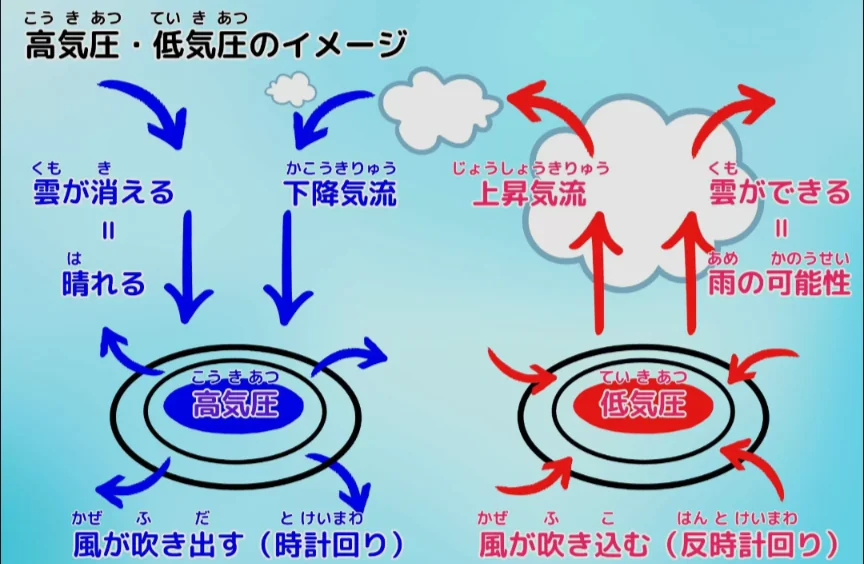
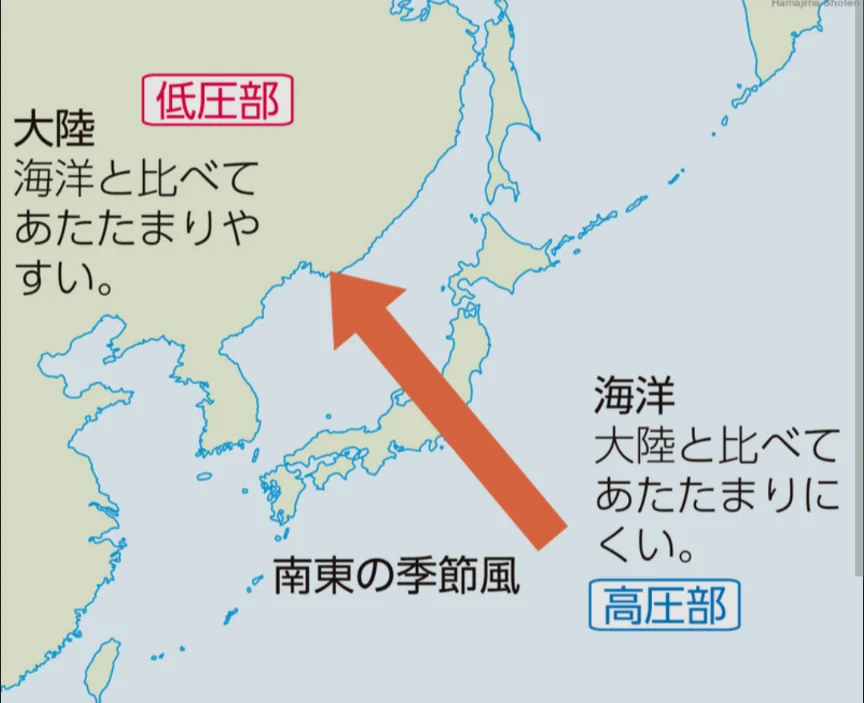
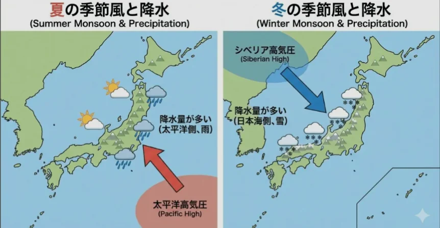
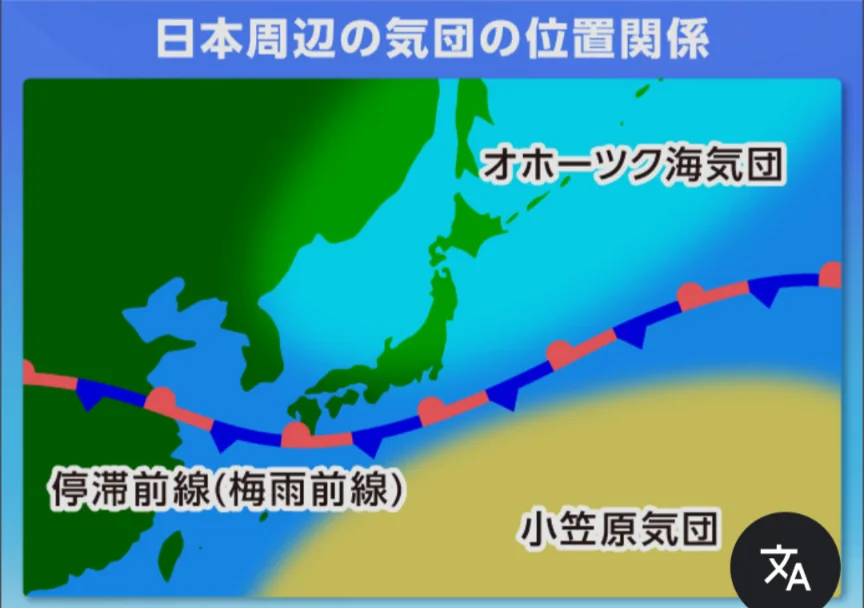

# 日本の気候

- 日本は南北に長く、また山地が多いため、地域によって気候が大きく異なります。
    - 沖縄と北海道以外は**温帯**に属します。
- 気候を理解するうえで欠かせないのが**季節風**（**モンスーン**）のメカニズムです。
- 大陸と海洋では温まりやすさ・冷えやすさが異なります。夏は大陸のほうが海洋より早く温まるため、大陸上の空気が上昇して**低気圧**になり、海洋から大陸へ向かって湿った風が吹き込みます。
    - 冬は逆に大陸が早く冷えるため、大陸から海洋へ向かって冷たく乾いた風が吹き出します。この季節によって向きが逆転する風が**季節風**です。2枚目の図は夏の季節風です。
        
        
        
    
    
    

- **夏**の日本には太平洋から南東の季節風が吹き込みます。温かく湿った空気が日本列島に大量の雨をもたらし、蒸し暑い夏になります。
- **冬**はユーラシア大陸から北西の季節風が吹き出します。大陸で冷やされた乾いた風が日本海を渡る間に水分を吸い上げ、山脈にぶつかって日本海側に大雪を降らせます。山を越えた風は水分を失って乾燥し、太平洋側には晴れた冬をもたらします。「日本海側は雪、太平洋側は晴れ」という冬の天気の対称性はこの仕組みで説明できます。
    
    
    

- **梅雨**は、太平洋からの湿った気流とオホーツク海からの冷たい気流がぶつかって前線を形成し、長雨をもたらします。
    
    
    

- **瀬戸内地方**（岡山・広島・香川など）は、中国山地と四国山地に挟まれているため、日本海側の雪も太平洋側の雨も届きにくく、年間を通じて温暖で晴れの日が多い温暖少雨な気候です。
- **北海道**は本州と異なり梅雨がほとんどなく、**冷帯**のため、夏でも冷涼で過ごしやすい気候です。
- **沖縄・南西諸島**は**亜熱帯気候**で、年間平均気温が約23℃と高く、サンゴ礁が広がります。
