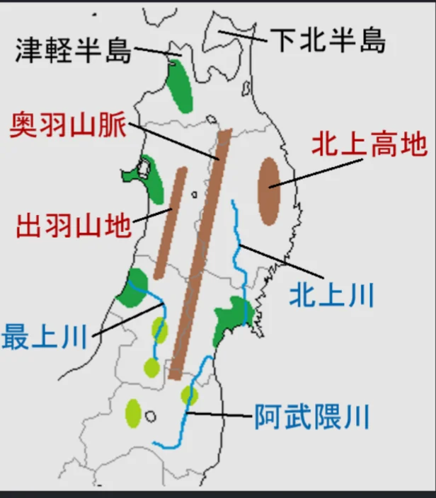

# 北海道・東北

- **北海道**は、明治時代に**屯田兵**（軍人農民）が送り込まれて開拓が進められた歴史を持ち、それ以前は**アイヌ民族**の土地でした。
- 広大な平野と冷涼な気候を活かした大規模農業が特徴で、じゃがいも・小麦・てんさい（砂糖の原料）・玉ねぎの生産量は全国1位です。

- **東北地方**（青森・岩手・宮城・秋田・山形・福島）は日本の米どころです。
- **北上川**・**最上川**などの河川が流れる盆地・平野で稲作が盛んで、山形のさくらんぼ・青森のりんごなど果樹農業も発達しています。
- **三陸海岸**は親潮と黒潮がぶつかる好漁場で、牡蠣・ホタテ・わかめの養殖が盛んです。
    
    
    
