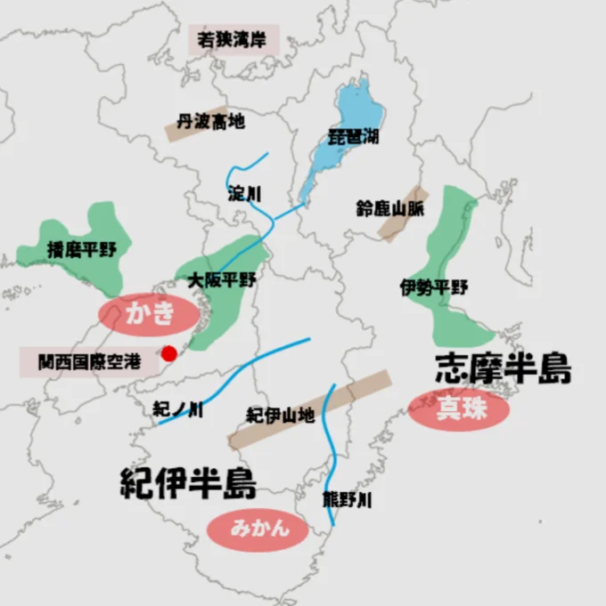

# 中部・近畿

- **中部地方**（新潟・富山・石川・福井・山梨・長野・岐阜・静岡・愛知）は、多様な地域性を持ちます。
- 日本海側の北陸（富山・石川・福井）は豪雪地帯で、冬の雪が豊富な水資源をもたらし、水力発電・コメ農業の基盤になっています。
- 石川県の金沢は江戸時代から**加賀百万石**（江戸時代の加賀藩の繁栄を表す言葉）の城下町として栄え、工芸・食文化が発展しました。
- 長野・山梨は内陸の盆地で、りんご・もも・ぶどうなど果樹農業が盛んです。
- 愛知県を中心とする**中京工業地帯**は日本最大の工業生産額を誇る工業地帯です。トヨタ自動車を核とする自動車産業が集積しています。

- **近畿地方**（大阪・京都・兵庫・奈良・滋賀・和歌山・三重）は古代から日本の中心だった地域です。
    
    
    

- 大阪は「**天下の台所**」として江戸時代から経済・商業の中心です。
- 京都は794年から1000年以上日本の首都だった古都で、神社仏閣・伝統工芸・食文化など日本の伝統文化の集積地です。
