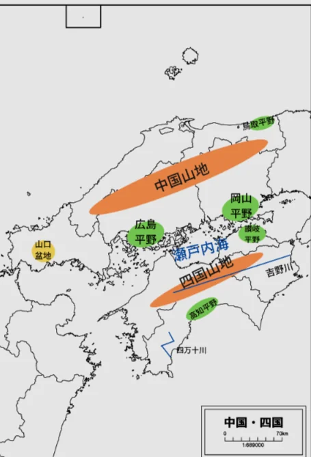
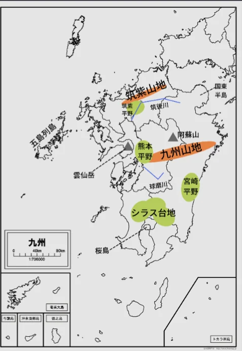

# 中国・四国・九州・沖縄

- **中国地方**（鳥取・島根・岡山・広島・山口）は、**山陰**（日本海側）と**山陽**（瀬戸内海側）で気候が大きく異なります。
    
    
    

- 山陰は冬に雪が多く人口が少ない一方、山陽は温暖で工業・都市が発展しています。
- **瀬戸内海**は本州・四国・九州に囲まれた穏やかな内海で、温暖少雨の気候を活かして柑橘類の生産が盛んで、みかん・レモン・ポンカンなどの産地が並びます。

- **九州**（福岡・佐賀・長崎・熊本・大分・宮崎・鹿児島）は、**阿蘇山**・**桜島**・**雲仙岳**など活火山が多く、温泉も豊富です。
    
    
    
- 熊本の阿蘇カルデラは世界最大級の**カルデラ**（火山活動でできた巨大な窪地）です。

- **沖縄**は南西諸島からなる島嶼地域で、本土と異なる亜熱帯気候・独自の文化を持ちます。かつて**琉球王国**として独立していた歴史を持ち、三線・エイサー・泡盛・沖縄料理など独自の文化が今も生きています。
