# 日本の世界遺産

- 日本の世界遺産で代表的なものを列挙します。
- **知床**、**縄文遺跡群**（北海道）
    - 縄文遺跡群は、三内丸山遺跡などを含む。
        
        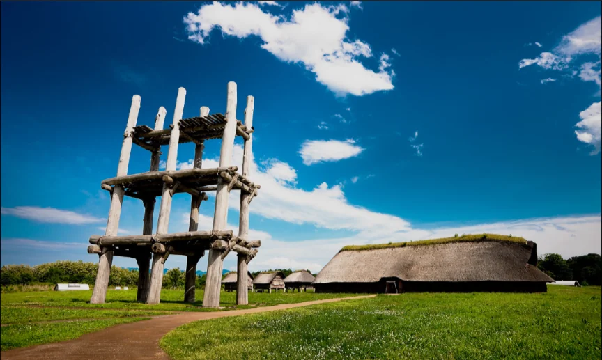
        
- **白神山地**（青森・秋田）
    - ブナ林。
- **平泉**（岩手）
    - 平安時代の奥州藤原氏が建立した浄土宗の寺。**中尊寺金色堂**が有名。
    
    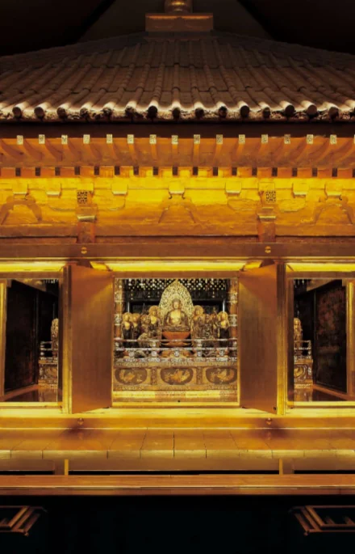
    
- **日光の社寺**（栃木）
    - 徳川家康の眠る**日光東照宮**。
    
    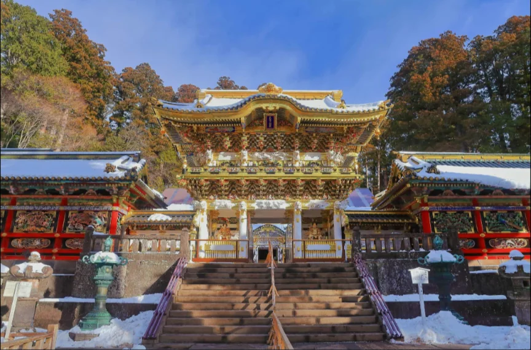
    
- **富岡製糸場**（群馬）
    - 明治以降の日本の発展に寄与した製糸場。
    
    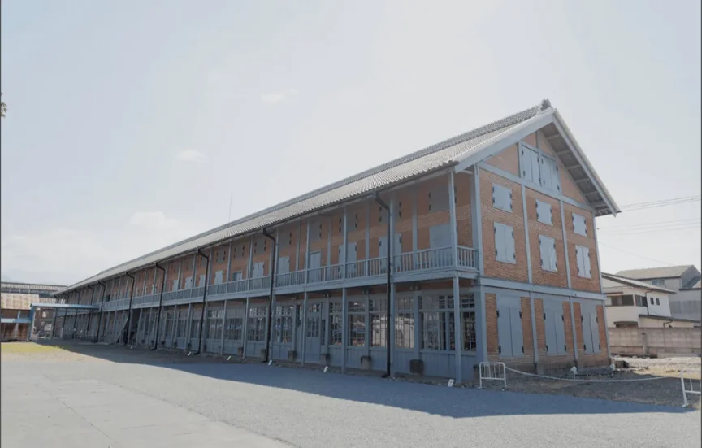
    
- **富士山**（山梨・静岡）
- **白川郷**（岐阜）
    - 雪を防ぐための**合掌造り**で有名。
    
    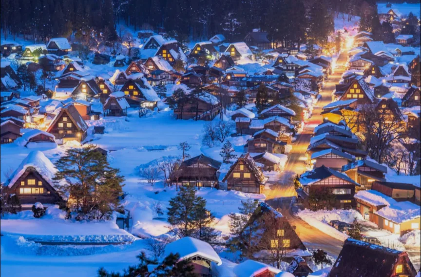
    
- **古都京都**
    - 下鴨神社、清水寺、延暦寺、平等院、金閣寺、二条城などなど。
    
    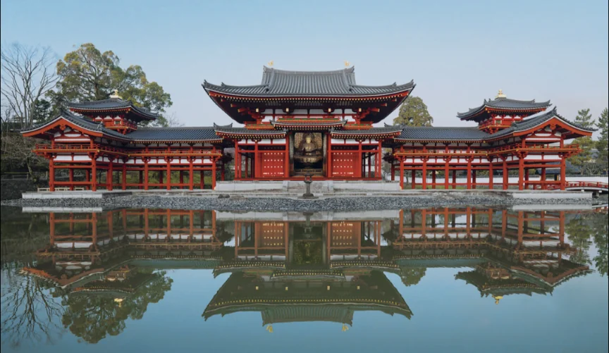
    
- **古都奈良**
    - 東大寺、興福寺、春日大社、薬師寺、平城京跡など。
- **法隆寺**（奈良）
    - 世界最古の木造建築物。聖徳太子が建立。
    
    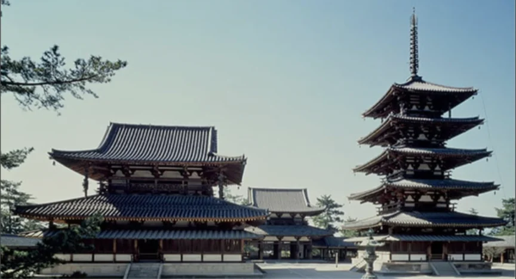
    
- **紀伊山地**（和歌山）
    - 那智大社と、そこに向かう参詣道。
    
    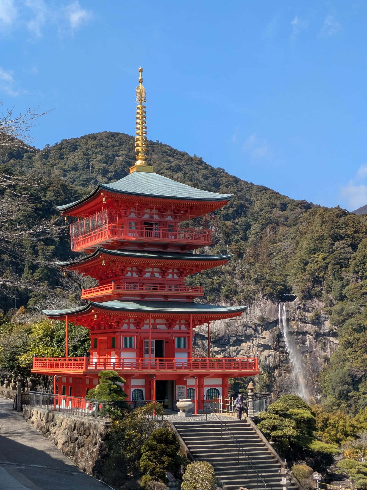
    
- **古市・百舌鳥古墳群**（大阪）
    - 古代の天皇の古墳。
    
    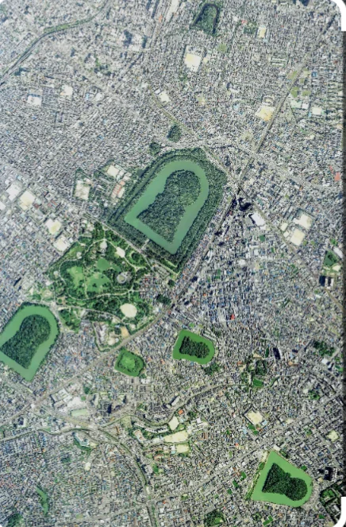
    
- **姫路城**（兵庫）
- **石見銀山**（島根）
    - 江戸時代ごろ、世界の銀の3分の1を産出したとされる。読み方は、「いわみ」銀山。
    
    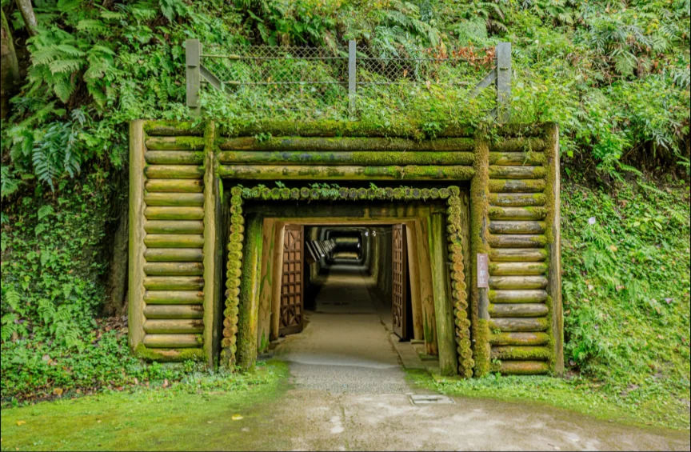
    
- **原爆ドーム**（広島）
- **厳島神社**（広島）
    - 海に浮かぶ大鳥居が有名。
    
    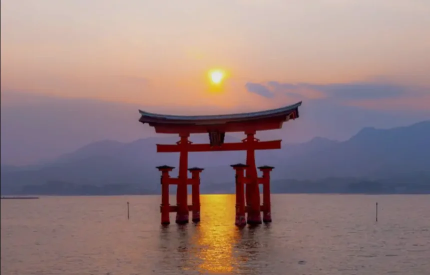
    
- **天草**（長崎）
    - 江戸時代に弾圧されたキリシタンの遺跡が残る。
    
    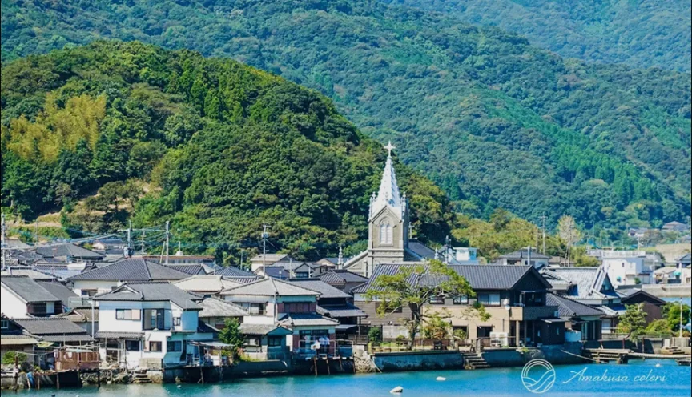
    
- **軍艦島**（長崎）
- **屋久島**（鹿児島）
    - **縄文杉**が有名。
- **奄美大島**（鹿児島）
    - **アマミノクロウサギ**などの固有種や自然。
- **琉球王国のグスク**（沖縄）
    - **首里城**の**守礼門**など。
    
    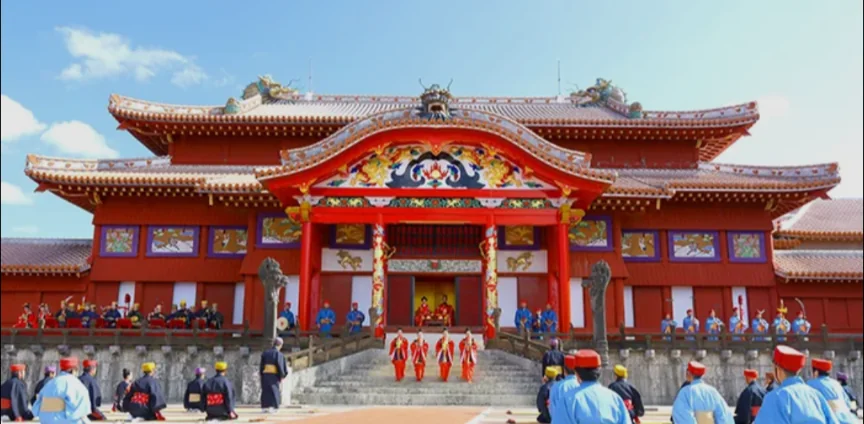
    
