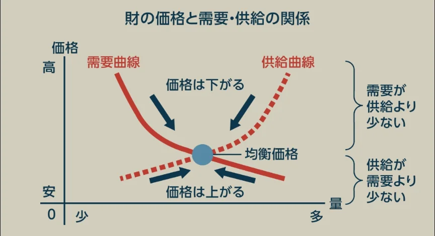

# 需要と供給・市場価格

- 市場経済の核心が**需要と供給**のメカニズムです。
- **需要**はある財・サービスを購入したいという欲求です。価格が下がると需要量が増え、価格が上がると需要量が減ります。
- **供給**は生産者が販売したいと思う量です。価格が上がると利益が増えるので供給量が増え、価格が下がると供給量が減ります。
- **均衡価格**は需要量と供給量が一致する価格で、需要曲線と供給曲線の交点で決まります。価格がこれより高いと「供給過多（売れ残り）」、低いと「需要過多（品不足）」が生じるため、価格は自然と均衡に向かって動きます。
    
    
    
- これが、**アダム・スミス**が「**神の見えざる手**」と表現した市場メカニズムです。
    
    
