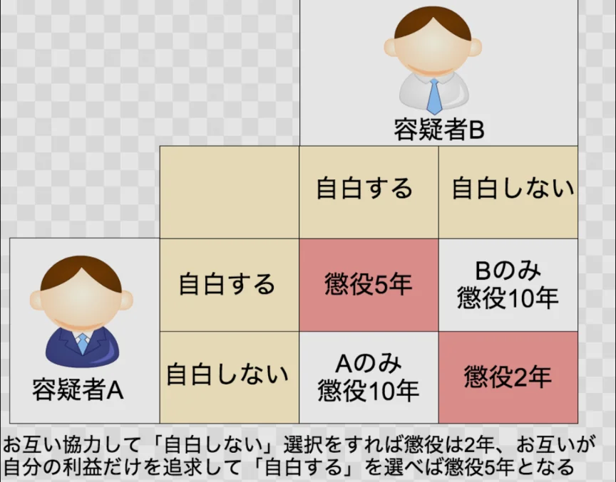

# ゲーム理論

- **ゲーム理論**は「複数の意思決定者（プレイヤー）が互いの行動を意識しながら意思決定する状況」を分析する数学的な理論です。
    - 経済学・政治学・生物学・軍事戦略など幅広い分野に応用されています。
- 最も有名な例が**囚人のジレンマ**です。
- 二人の容疑者AとBがいます。お互い通信できない状態で「自白する」か「黙秘する」かを選びます。それぞれ自白した場合（or 自白しない場合）にどうなるかは、以下の表の通りです。片方のみが自白した場合は、自白した側が懲役10年となり、不利な条件になります。
    
    
    
- 二人が「協力（黙秘）」すれば合計4年の刑で最も良い結果ですが、合理的に考えると両者とも「自白」を選びます（Aからすると、Bがどちらを選ぼうとも、自白した方が自分にとってマシな結果になる）。
- 結果、両者とも5年という、協力すれば達成できた結果より悪い状況になります。
- 囚人のジレンマは現実の多くの問題を説明します。軍拡競争（両国とも軍備縮小すれば両方得をするが、一方的に縮小すれば危険なので縮小できない）、環境問題（各国が排出を削減すれば全員得をするが、自国だけ削減すると損になる）、価格競争などがその例です。
